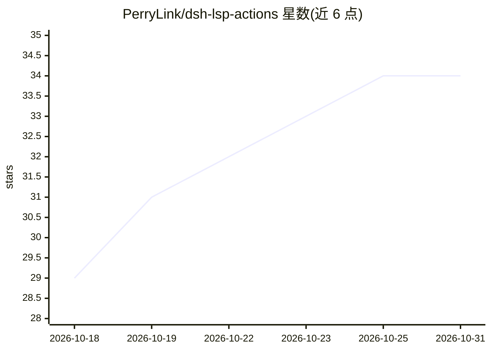

# PerryLink/dsh-lsp-actions

⭐ 34 · TypeScript · Apache-2.0 · 推送 2026-10-27 · [GitHub](https://github.com/PerryLink/dsh-lsp-actions) · [官网](https://perrylink.github.io/plugins/dsh-lsp-actions/) · 个人维护 · 中文 README

**给 DeepSeek Harness 补齐 LSP 操作面的插件：诊断/补全/重构等 8 类工具**

DeepSeek Harness（DSH）的插件，为 agent 的编辑器循环提供 LSP 操作面：8 个 lsp_* 工具（诊断、格式化、补全、代码操作、符号、签名帮助、inlay hints、重命名），由配置指定的语言服务器（如 typescript-language-server）通过内置 stdio 客户端提供服务，插件本身不调用模型。另提供编辑器动作协议 v1（JSON-RPC 的 lsp.actions.list/run/events），供 VS Code 等编辑器直连；写操作走官方权限预设与审批（fs/write-intent、sandbox 升级）。路由按 fileGlobs、projectMarkers 向上回溯、扩展名映射三级确定性匹配。通过 dsh plugin 命令安装（git/npm/tarball 三通道）。

## 筛选速览

| 维度 | 判定 | 备注 |
|---|---|---|
| AI 角色 | `ai-ecosystem` | LLM/agent 周边工具 |
| 许可风险 | `permissive` | Apache-2.0 |
| 部署形态 | `library` | 以包/库形式分发 |
| 模型依赖 | locked-api |  |
| 硬件要求 | — | 无带数字的原话,不猜 |
| 安装摩擦 | `low` | 无编译、无系统依赖或容器化 |
| 成熟度 | — | 结构信号不足 |

## 能力要点

- 8 个 lsp_* 工具覆盖诊断、格式化、补全、代码操作、符号、签名、inlay hints、重命名
- 编辑器动作协议 v1（JSON-RPC，冻结版本、仅增量演进）供任意编辑器消费
- 写操作经官方权限预设与 fs/write-intent 审批，read-only 会话拒绝并支持受控升级
- 三级确定性服务器路由：fileGlobs → projectMarkers 祖先回溯 → 扩展名映射

## 适用场景

- 让 agent 在写码后立即获得语言服务器的诊断与补全反馈
- 以 VS Code 为前端、DSH 为无头后端组成编辑环境
- 在多项目 monorepo 中按项目配置文件自动路由到各自的语言服务器

## 场景标签

 · 领域:开发者工具/AI agent 基础设施

## 证据(README 行号)

> L59: |Model|Any (tools are model-agnostic; the plugin never calls a model)|
> L63: `dsh-lsp-actions` mounts as a single host row (`id: lsp-actions`, `name: dsh-lsp-actions`, `inject: [tools, fs, sub

## 星数曲线

2026-10-18 29 → 2026-10-31 34（+5）

---
*卡片 v1 · prompt 1.4 · 生成 2026-10-25 · 置信度 high · 依据 README sha `a8efb1aa5edb` · [字段定义](../../DATASET.md)*
