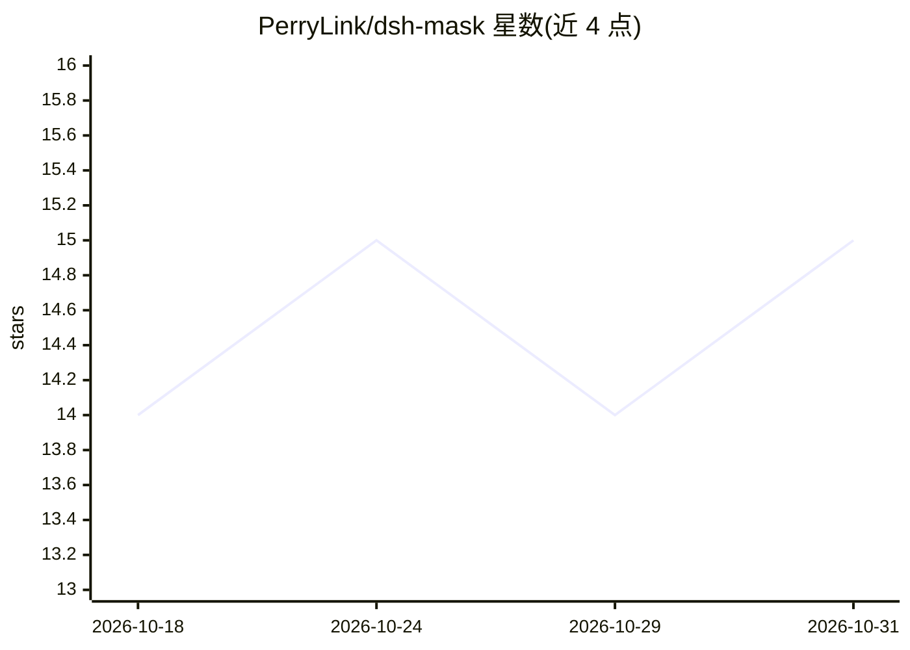

# PerryLink/dsh-mask

⭐ 15 · JavaScript · Apache-2.0 · 推送 2026-10-24 · [GitHub](https://github.com/PerryLink/dsh-mask) · [官网](https://perrylink.github.io/plugins/dsh-mask/) · 个人维护 · 中文 README

**DeepSeek Harness 的 PII 脱敏插件：模型边界前置匿名化**

面向 DeepSeek Harness（DSH）的 Cordis 插件，在消息到达模型前的 agent/pre-step 边界将手机号、邮箱、身份证号、银行卡号、密钥等改写为占位符，明文不进入会话日志；占位符→原文的还原表仅存于内存与受控的 dsh_mask 存储域，/mask restore 命令可将明文以 0600 权限文件形式交付。检测采用零依赖正则（纯主机、无网络请求），电话与身份证模式仅匹配中国大陆格式；person/address 识别需外部 NER 且当前 fail loudly。限制：无裸存储栈的 profile 中还原表仅存内存，重启即失。

## 筛选速览

| 维度 | 判定 | 备注 |
|---|---|---|
| AI 角色 | `ai-ecosystem` | LLM/agent 周边工具 |
| 许可风险 | `permissive` | Apache-2.0 |
| 部署形态 | `library` | 以包/库形式分发 |
| 模型依赖 | locked-api |  |
| 硬件要求 | — | 无带数字的原话,不猜 |
| 安装摩擦 | `low` | 无编译、无系统依赖或容器化 |
| 成熟度 | — | 结构信号不足 |

## 能力要点

- agent/pre-step 边界前置脱敏，明文不进入会话日志与模型输入
- 还原表仅存内存与受控 dsh_mask 存储域，可持久化或关闭
- /mask 命令（status/on/off/restore）与 mask_test 工具
- 零依赖正则检测，无网络请求、不存储凭据，失败即 fail closed

## 适用场景

- 在使用 DeepSeek Harness 的 agent 会话中防止个人信息进入模型与日志
- 需要可逆脱敏：占位符发送给模型、明文留在本地受控还原
- 对工具结果文本（tools/post-execute）也做脱敏处理

## 场景标签

 · 领域:AI 安全/隐私工具

## 证据(README 行号)

> L7: **PII masking middleware for DeepSeek Harness — anonymize personal data before it reaches the model, keep it reversi
> L71: `dsh-mask` anonymizes personal data **at the model boundary** — before a message reaches the model — and keeps a re

## 星数曲线

2026-10-18 14 → 2026-10-31 15（+1）

---
*卡片 v1 · prompt 1.4 · 生成 2026-10-31 · 置信度 high · 依据 README sha `4d03c70920db` · [字段定义](../../DATASET.md)*
