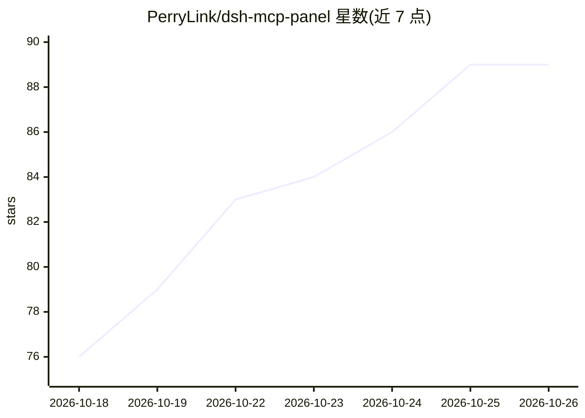

# PerryLink/dsh-mcp-panel

⭐ 89 · TypeScript · Apache-2.0 · 推送 2026-10-24 · [GitHub](https://github.com/PerryLink/dsh-mcp-panel) · [官网](https://perrylink.github.io/plugins/dsh-mcp-panel/) · 个人维护 · 中文 README

**DeepSeek Harness 官方 MCP 客户端的管理控制台插件**

面向 DeepSeek Harness（dsh）官方 MCP 客户端 @deepseek-ai/dsh-mcp-client 的体验层插件：不替换桥接客户端，通过 /mcp 命令读取各 MCP 服务器的传输、工具数、连接状态与最后错误，派生自愈建议（health），支持服务器增删改（表单→cordis.patch.yml 追加式补丁、批准门控、自动备份）与经官方工具管线的试用调用。设置页提供 MCP 标签页（状态卡片、CRUD、工具试用台、资源浏览器、推荐服务器目录）。写入仅限 profile 补丁层，凭据在渲染前脱敏。兼容 dsh ≥0.2.1-0 <0.3.0、Node ^22.19.0||>=24。

## 筛选速览

| 维度 | 判定 | 备注 |
|---|---|---|
| AI 角色 | `ai-ecosystem` | LLM/agent 周边工具 |
| 许可风险 | `permissive` | Apache-2.0 |
| 部署形态 | `library` | 以包/库形式分发 |
| 模型依赖 | locked-api |  |
| 硬件要求 | — | 无带数字的原话,不猜 |
| 安装摩擦 | `low` | 无编译、无系统依赖或容器化 |
| 成熟度 | — | 结构信号不足 |

## 能力要点

- /mcp 命令族：状态行、tools、health（派生自愈建议）、enable/disable、probe、经官方 ctx.tools.execute() 管线的 call 试用
- 服务器 CRUD 生成 cordis.patch.yml 追加式补丁：批准门控写入、自动备份、写后校验
- 凭据脱敏：URL/密码/header/token/JWT 渲染前脱敏，header 值不离开宿主
- 内置社区 MCP 服务器推荐目录（filesystem、git、github、fetch、playwright 等），catalogEntries 可覆盖

## 适用场景

- 在设置页为 DeepSeek Harness 添加、编辑、启停 MCP 服务器而不用手写 YAML
- 查看各 MCP 服务器连接状态并按 health 建议排查故障
- 在面板里试用调用 mcp__* 工具、预览结果而不进入模型上下文

## 场景标签

`LLM 可观测性` · 领域:评测与运维

## 证据(README 行号)

> L46: The MCP management console for the official DeepSeek Harness MCP client — add, edit, remove, and trial-call MCP ser
> L82: `@deepseek-ai/dsh-mcp-client` is the **only bridge**: one plugin instance per MCP server, configured as a hand-writ

## 星数曲线

2026-10-18 76 → 2026-10-26 89（+13）

---
*卡片 v1 · prompt 1.4 · 生成 2026-10-24 · 置信度 high · 依据 README sha `b4df2af0c8d8` · [字段定义](../../DATASET.md)*
