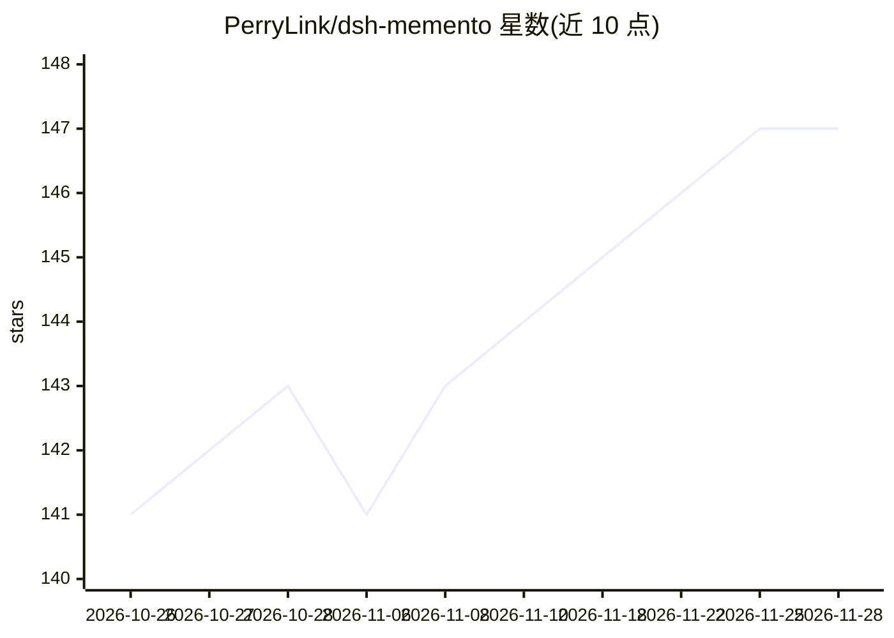

# PerryLink/dsh-memento

⭐ 147 · JavaScript · Apache-2.0 · 推送 2026-11-24 · [GitHub](https://github.com/PerryLink/dsh-memento) · [官网](https://www.npmjs.com/package/dsh-memento) · 个人维护 · 中文 README

**给 DeepSeek Harness 加审批门控跨会话记忆的插件**

面向 DeepSeek Harness 的社区记忆插件：提供类型安全的 ctx.memory 服务接缝、本地 SQLite 提供方（node:sqlite，WAL，权限 0600）、memory 工具与冻结快照注入。记忆按 user/agent 两轨 × user-global/workspace 两层 × agentPreset 隔离，各轨各层有硬字符预算（默认 user 2000 / agent 4000），写满返回结构化错误而非截断。每条写路径经过服务内部审批门（writePolicy ask/auto/off），审计由 approval/asked + approval/decided 审计对与插件审计表构成；另附只读 stdio MCP 服务器供 Claude、Codex 等外部客户端检索。

## 筛选速览

| 维度 | 判定 | 备注 |
|---|---|---|
| AI 角色 | `ai-ecosystem` | LLM/agent 周边工具 |
| 许可风险 | `permissive` | Apache-2.0 |
| 部署形态 | `library` | 以包/库形式分发 |
| 模型依赖 | — | README 未给出锁定关系 |
| 硬件要求 | — | 无带数字的原话,不猜 |
| 安装摩擦 | `low` | 无编译、无系统依赖或容器化 |
| 成熟度 | — | 结构信号不足 |

## 能力要点

- 每条写路径强制经过服务内部审批门，被拒写入落 *-denied 审计行
- 两轨两层 × agentPreset 隔离，各配硬字符预算，写满返回结构化错误
- 零依赖本地 SQLite 存储，零网络、零凭据，卸载不删库
- 附带只读 stdio MCP 服务器与 dsh-memory-protocol v1 协议规范

## 适用场景

- 让 agent 在跨会话时记住用户偏好与环境约定
- 要求每条记忆写入都有人工审批与可重建审计链
- 通过 MCP 客户端在 harness 之外只读检索记忆库

## 场景标签

`Agent 记忆` · 领域:Agent 开发

## 证据(README 行号)

> L9: 一个类型安全的 `ctx.memory` 接缝 + 本地 SQLite 提供方 + `memory` 工具 + 冻结快照注入：别的记忆插件卖仓库，这个插件卖接缝、写审批门与会话可重建的审计。
> L40: 写下一条值得记住的事，它就在下一次会话开头等着模型——而那次写入过了审批门、留了审计行。、`dsh-memento` 给 DeepSeek Harness 补的是**能力接缝**，不是又一个记忆仓库：一个类型安全的 `ctx.me
> L108: |`memory`|工具|带 Save/Skip 指引的 add/replace/remove/consolidate/query；写入走审批门|

## 星数曲线

2026-10-26 141 → 2026-11-28 147（+6）

---
*卡片 v1 · prompt 1.4 · 生成 2026-11-27 · 置信度 high · 依据 README sha `61dd9b936d18` · [字段定义](../../DATASET.md)*
