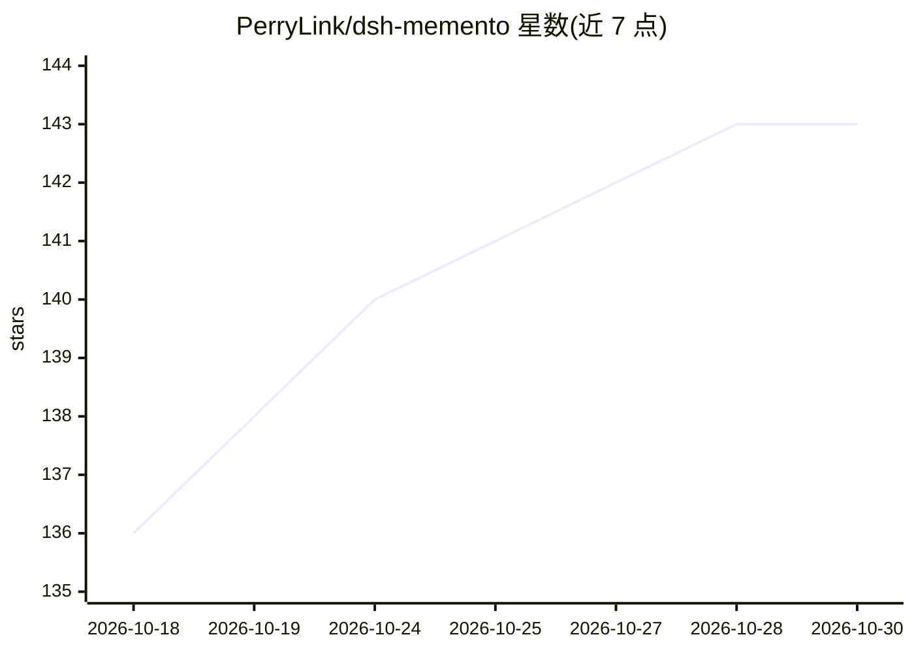

# PerryLink/dsh-memento

⭐ 143 · JavaScript · Apache-2.0 · 推送 2026-10-26 · [GitHub](https://github.com/PerryLink/dsh-memento) · [官网](https://perrylink.github.io/plugins/dsh-memento/) · 个人维护 · 中文 README

**DeepSeek Harness 的跨会话记忆插件：审批门控+可审计的 ctx.memory 能力层**

面向 DeepSeek Harness 的记忆插件（DSH 插件家族成员，Apache-2.0）：提供类型化 ctx.memory 服务 seam、零依赖本地 SQLite provider（node:sqlite、WAL、0600 权限）、memory 工具与注入系统提示词的冻结快照。所有写路径强制经过审批瀑布（ask/auto/off 策略对模型不可见），每次写入可从审批对与插件审计表重建；user/agent 双轨道×user-global/workspace 双层，按 agentPreset 隔离，带硬性字符预算，满载报错不截断。通过 dsh plugin 命令或 npm/git/tarball 渠道安装，支持 Windows/macOS/Linux。

## 筛选速览

| 维度 | 判定 | 备注 |
|---|---|---|
| AI 角色 | `ai-ecosystem` | LLM/agent 周边工具 |
| 许可风险 | `permissive` | Apache-2.0 |
| 部署形态 | `library` | 以包/库形式分发 |
| 模型依赖 | locked-api |  |
| 硬件要求 | — | 无带数字的原话,不猜 |
| 安装摩擦 | `low` | 无编译、无系统依赖或容器化 |
| 成熟度 | — | 结构信号不足 |

## 能力要点

- 类型化 ctx.memory seam + 零依赖 SQLite provider
- 所有写路径强制经过审批门控，模型路径不可绕过，拒绝的写入也留审计行
- user/agent 双轨道双层结构，按 agentPreset 隔离，硬性字符预算
- 冻结快照每会话注入一次系统提示词，写入可从审批对+审计表重建

## 适用场景

- 让 DeepSeek Harness 的 agent 跨会话记住用户与环境事实
- 对 agent 记忆写入做人工审批与审计追溯
- 在不同工作区/预设间隔离维护记忆条目

## 场景标签

`Agent 记忆` · 领域:Agent 开发

## 证据(README 行号)

> L7: **Bounded, layered, approval-gated, auditable cross-session memory for DeepSeek Harness.**
> L67: `dsh-memento` is a capability seam, not another memory warehouse: a typed `ctx.memory` service, a local SQLite prov

## 星数曲线

2026-10-18 136 → 2026-10-30 143（+7）

---
*卡片 v1 · prompt 1.4 · 生成 2026-10-22 · 置信度 high · 依据 README sha `0a93f3541803` · [字段定义](../../DATASET.md)*
