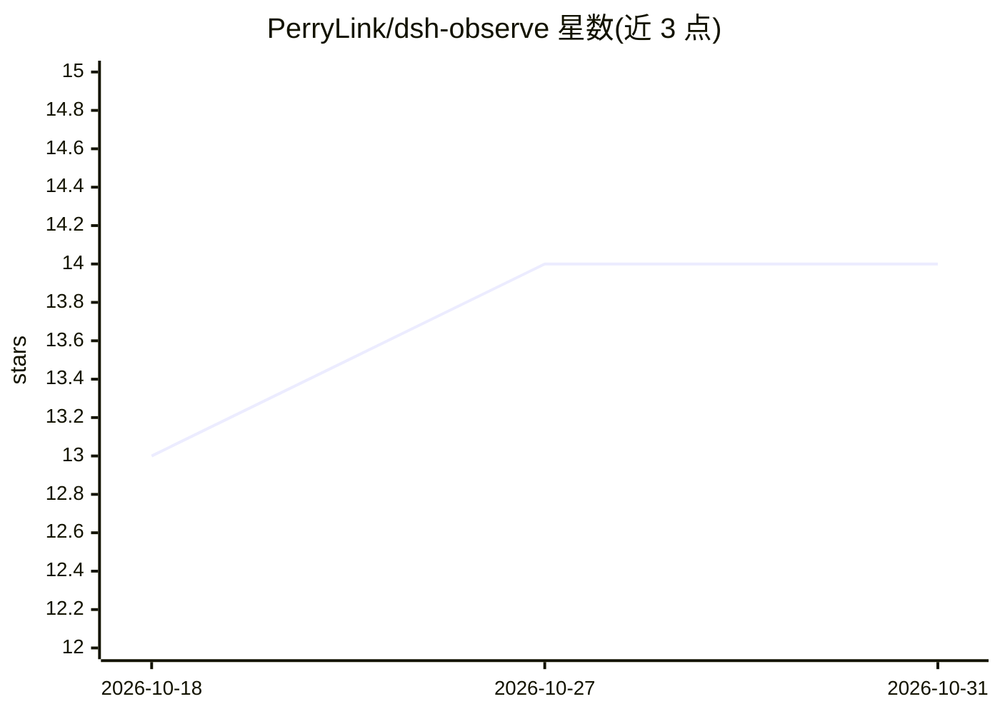

# PerryLink/dsh-observe

⭐ 14 · TypeScript · Apache-2.0 · 推送 2026-10-26 · [GitHub](https://github.com/PerryLink/dsh-observe) · [官网](https://perrylink.github.io/plugins/dsh-observe/) · 个人维护 · 中文 README

**DeepSeek Harness 的 OpenTelemetry/Langfuse 可观测性导出插件**

面向 DeepSeek Harness（dsh）的后台导出插件：将 session 事件流转换为 OTLP traces/metrics 与 Langfuse 观测数据，输出 turn/step/tool-call/LLM 生成 span、按模型统计的 token 与 USD 成本计数。发送前对 prompt/completion 做密钥脱敏与截断；含异步批处理、有界离线缓冲、指数退避重试与运行时停止开关；默认关闭，需显式开启。无用户命令面，仅通过配置运行。

## 筛选速览

| 维度 | 判定 | 备注 |
|---|---|---|
| AI 角色 | `ai-ecosystem` | LLM/agent 周边工具 |
| 许可风险 | `permissive` | Apache-2.0 |
| 部署形态 | `library` | 以包/库形式分发 |
| 模型依赖 | — | README 未给出锁定关系 |
| 硬件要求 | — | 无带数字的原话,不猜 |
| 安装摩擦 | `low` | 无编译、无系统依赖或容器化 |
| 成熟度 | `idea` | |

## 能力要点

- turn/step/tool/LLM span 导出为 OTLP 与 Langfuse 观测
- token 与 USD 成本计数（可配置定价表）
- 脱敏（密钥模式+截断）先于任何发送，离线缓冲仅存脱敏记录
- 异步批处理、有界离线缓冲、指数退避重试、默认关闭

## 适用场景

- 为 DeepSeek Harness 会话接入 OpenTelemetry 或 Langfuse 后端
- 按模型统计 agent 会话的 token 与成本
- 需要脱敏后再外发观测数据的合规场景

## 场景标签

`LLM 可观测性` · 领域:评测与运维

## 证据(README 行号)

> L7: **OpenTelemetry and Langfuse observability exporter for DeepSeek Harness.**
> L60: |Backends|OpenTelemetry OTLP/HTTP (traces + metrics, JSON encoding) and Langfuse (LLM observability) — either or bo
> L67: - **Spans** — turn, step, tool-call (duration, status, retry derivation), and LLM generation spans, linked into per

## 星数曲线

2026-10-18 13 → 2026-10-31 14（+1）

---
*卡片 v1 · prompt 1.4 · 生成 2026-10-31 · 置信度 high · 依据 README sha `503f64799c48` · [字段定义](../../DATASET.md)*
