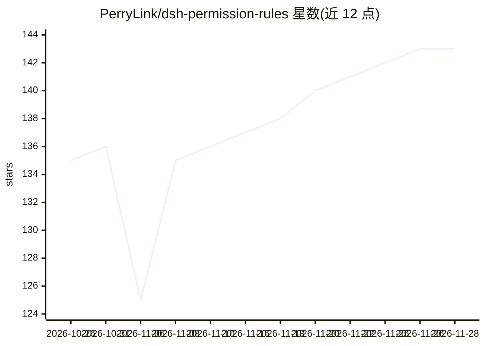

# PerryLink/dsh-permission-rules

⭐ 143 · TypeScript · Apache-2.0 · 推送 2026-11-25 · [GitHub](https://github.com/PerryLink/dsh-permission-rules) · [官网](https://www.npmjs.com/package/dsh-permission-rules) · 个人维护 · 中文 README

**为 DeepSeek Harness 提供声明式工具调用权限规则与网络出站管控的插件**

挂在 DeepSeek Harness `tools/pre-execute` waterfall 上的社区插件：以 YAML 编写有序 allow/deny/ask 规则链，按工具名 glob、参数键/值（glob/正则）、工作区路径、agent 身份、环境变量等维度对每次工具调用做首个匹配裁决；ask 走官方审批接缝由评审模型或人作答。另带 Codex 风格进程级网络策略：shell 子进程出站流量经内置本地 HTTP/CONNECT 代理按网络规则裁决。裁决以会话事件落盘审计，支持热重载、试运行模式、内置高危基线与分层规则文件。仅适配 DeepSeek Harness（核验至 v0.2.3-alpha.1），与官方无关。

## 筛选速览

| 维度 | 判定 | 备注 |
|---|---|---|
| AI 角色 | `ai-ecosystem` | LLM/agent 周边工具 |
| 许可风险 | `permissive` | Apache-2.0 |
| 部署形态 | `library` | 以包/库形式分发 |
| 模型依赖 | locked-api |  |
| 硬件要求 | — | 无带数字的原话,不猜 |
| 安装摩擦 | `low` | 无编译、无系统依赖或容器化 |
| 成熟度 | — | 结构信号不足 |

## 能力要点

- 纯 YAML 有序规则链，首个匹配胜出，支持工具名/参数/路径/agent 身份/环境条件多维匹配
- 内置本地 HTTP/CONNECT 代理治理 shell 子进程出站流量，含上游链式与凭据打码
- 每次命中与透传以 permissionRules/decision 会话事件仅日志审计，带稳定 ruleId
- 热重载、试运行（enforce:false）、内置高危基线与 /rules test 干跑命令

## 适用场景

- 限制 AI agent 可执行的工具与命令（如禁止 push 到受保护路径）
- 管控 agent shell 子进程的出站网络访问（白名单/全禁/全放）
- 对 agent 权限裁决做跨会话、跨主机的审计账本聚合

## 场景标签

`网络安全` · 领域:学习与行业

## 证据(README 行号)

> L9: 面向 DeepSeek Harness 的 Claude Code 风格声明式权限中间件：规则裁决已知的，评审模型裁决未知的；另带一套 Codex 风格的进程级网络策略与本地代理，管住 shell 子进程的出站流量。
> L40: `dsh-permission-rules` 在 `tools/pre-execute` waterfall 上为每次工具调用前置一份有序的 **`allow` / `deny` / `ask`** 规则列表——确定、即时、可审计
> L92: - **`ask`** 走官方审批接缝（挂载 `dsh-auto-review` 用第二模型作答，或由人作答；两者皆无时 harness 失败关闭）。

## 星数曲线

2026-10-26 135 → 2026-11-28 143（+8）

---
*卡片 v1 · prompt 1.4 · 生成 2026-11-27 · 置信度 high · 依据 README sha `9a47113d696b` · [字段定义](../../DATASET.md)*
