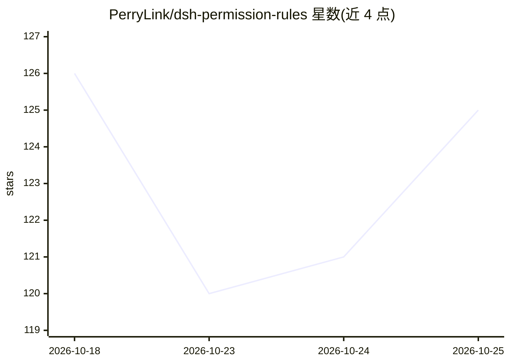

# PerryLink/dsh-permission-rules

⭐ 125 · TypeScript · Apache-2.0 · 推送 2026-10-23 · [GitHub](https://github.com/PerryLink/dsh-permission-rules) · [官网](https://perrylink.github.io/plugins/dsh-permission-rules/) · 个人维护 · 中文 README

**DeepSeek Harness 的声明式权限规则插件：工具调用前 allow/deny/ask 把关**

面向 DeepSeek Harness（DSH）的插件，在 tools/pre-execute 瀑布上以 YAML 声明有序的 allow/deny/ask 规则：按工具名、参数 glob/regex、工作区路径、agent 身份与 shell 命令分解匹配；deny 阻断并返回 reason，ask 走官方审批通道，allow 经 next() 透传。内置高危基线规则集、层级规则文件合并、Chokidar 热重载与失败保持旧规则、dry-run 模式，另提供进程级网络策略（本地 HTTP/CONNECT 代理按域名/IP/端口裁决）。每次命中与透传均写入会话日志审计。通过 dsh plugin 命令（git/npm/tarball 三渠道）安装，需 Node ^22.19.0 或 >=24。

## 筛选速览

| 维度 | 判定 | 备注 |
|---|---|---|
| AI 角色 | `ai-ecosystem` | LLM/agent 周边工具 |
| 许可风险 | `permissive` | Apache-2.0 |
| 部署形态 | `library` | 以包/库形式分发 |
| 模型依赖 | locked-api |  |
| 硬件要求 | — | 无带数字的原话,不猜 |
| 安装摩擦 | `low` | 无编译、无系统依赖或容器化 |
| 成熟度 | — | 结构信号不足 |

## 能力要点

- 有序 allow/deny/ask 规则在 tools/pre-execute 瀑布上裁决工具调用
- 内置高危基线规则集（破坏性命令/提权/下载执行等），用户规则可覆盖
- 进程级网络策略：本地代理按 domains/ips/ports/schemes 规则裁决出站连接
- 命中与透传均记 permissionRules/decision 会话审计事件，支持热重载与 dry-run

## 适用场景

- 为 AI agent 的工具调用配置确定性的允许/拒绝/需审批策略
- 拦截破坏性命令、提权与敏感路径访问
- 限制 agent 子进程的出站网络目标
- 上线前以 dry-run 模式审计策略实际会产生的裁决

## 场景标签

 · 领域:AI Agent 基础设施/安全

## 证据(README 行号)

> L7: **Claude Code-style declarative permission rules for DeepSeek Harness.**
> L44: Claude Code-style declarative permission rules for DeepSeek Harness.
> L63: `dsh-permission-rules` puts an ordered **`allow` / `deny` / `ask`** rule list in front of every tool call on the `t

## 星数曲线

2026-10-18 126 → 2026-10-25 125（-1）

---
*卡片 v1 · prompt 1.4 · 生成 2026-10-23 · 置信度 high · 依据 README sha `cb4b2f3668f0` · [字段定义](../../DATASET.md)*
