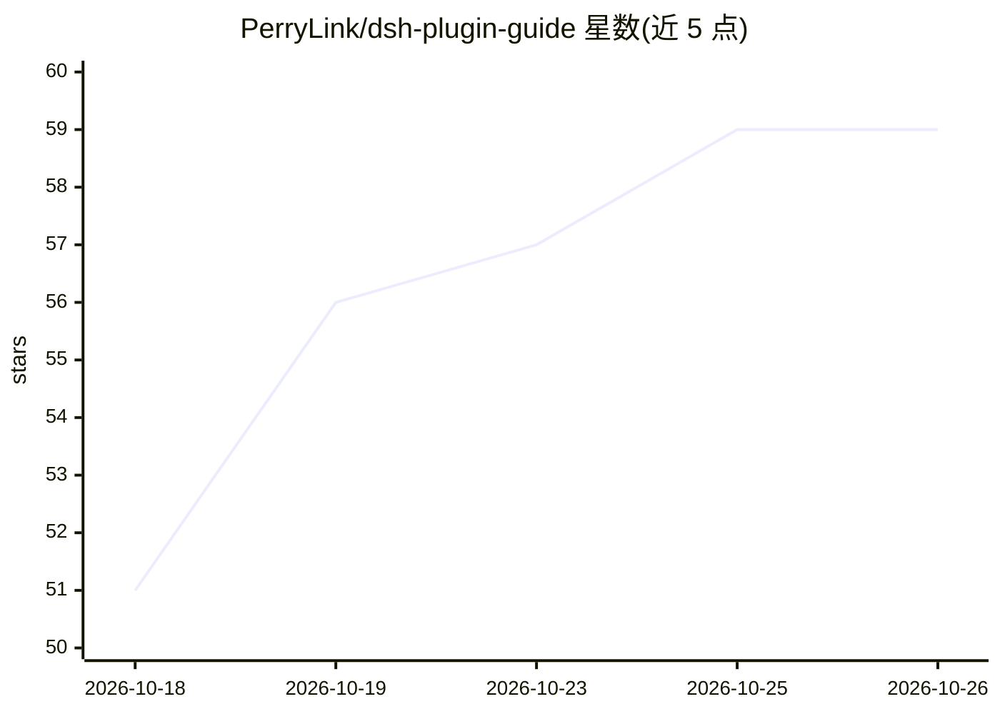

# PerryLink/dsh-plugin-guide

⭐ 59 · TypeScript · Apache-2.0 · 推送 2026-10-24 · [GitHub](https://github.com/PerryLink/dsh-plugin-guide) · [官网](https://perrylink.github.io/plugins/dsh-plugin-guide/) · 个人维护 · 中文 README

**DeepSeek Harness 插件开发知识库与 CLI 工具链，装为 agent 技能**

面向 DeepSeek Harness (dsh) 插件作者的知识库与工具链打包：以 DSH bundle 安装后注册为 agent 技能，含 10 章开发指南、官方文档逐字镜像（429 页，EN+ZH）、版本兼容矩阵、迁移指南（19 个可引用断点）、22+11 条源码验证的未修复问题索引、30+ 实战陷阱及 114 个社区仓库档案；附带零依赖 CLI dsh-plugin-dev 提供 new/check/verify/seams 四个子命令做脚手架、16 项静态检查与打包验证。限制：目标宿主 DSH 全部版本为 prerelease，无稳定线；git 渠道安装需 pnpm 构建白名单。

## 筛选速览

| 维度 | 判定 | 备注 |
|---|---|---|
| AI 角色 | `ai-knowledge` | 知识聚合/清单类 |
| 许可风险 | `permissive` | Apache-2.0 |
| 部署形态 | `library` | 以包/库形式分发 |
| 模型依赖 | — | README 未给出锁定关系 |
| 硬件要求 | — | 无带数字的原话,不猜 |
| 安装摩擦 | `low` | 无编译、无系统依赖或容器化 |
| 成熟度 | `idea` | |

## 能力要点

- 10 章开发指南 + 429 页官方文档逐字镜像（EN+ZH）
- dsh-plugin-dev CLI：脚手架/静态检查/打包验证/API 断点查询
- 版本矩阵与迁移指南：19 个可引用断点各带症状与修复
- 22+11 条源码级未修复问题索引（path:line、workaround）

## 适用场景

- 开发 DSH 插件时让 agent 引用确切文档页而非猜测 API
- 在 prerelease 版本间选择 peerDependencies 范围并处理破坏性变更
- 用 CLI 脚手架与静态检查验证插件正确性
- 查阅社区生态与已验证的未修复上游问题

## 场景标签

`代码生成` · 领域:编码与开发

## 证据(README 行号)

> L5: The DeepSeek Harness plugin-development knowledge base, installed *as an agent skill* — official docs, a version-com
> L97: `dsh-plugin-guide` is the DSH plugin-development knowledge base plus a CLI toolchain, packaged as one installable b
> L114: |`SKILL.md`|The `dsh-plugin-guide` agent skill: hard rules + task-based development paths|

## 星数曲线

2026-10-18 51 → 2026-10-26 59（+8）

---
*卡片 v1 · prompt 1.4 · 生成 2026-10-24 · 置信度 high · 依据 README sha `927c60ef2190` · [字段定义](../../DATASET.md)*
