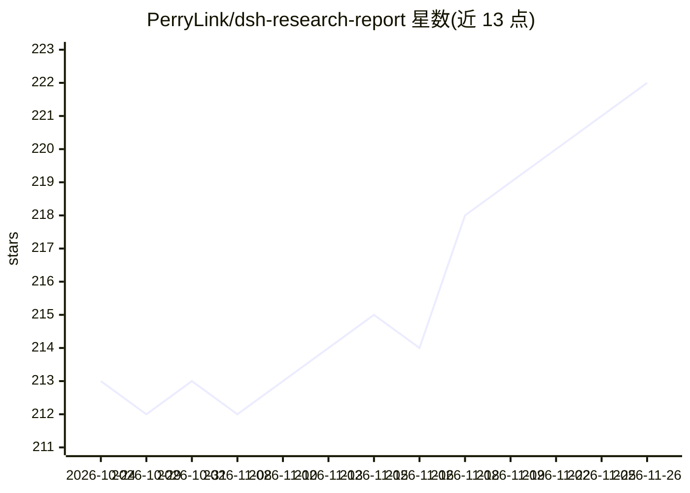

# PerryLink/dsh-research-report

⭐ 222 · TypeScript · Apache-2.0 · 推送 2026-11-24 · [GitHub](https://github.com/PerryLink/dsh-research-report) · [官网](https://www.npmjs.com/package/dsh-research-report) · 个人维护 · 中文 README

**给 DeepSeek Harness 提供可离线复核的封存研究报告插件**

DeepSeek Harness 的社区插件（与官方无关）：给模型一个主题与来源后，将每条结论绑定到内容寻址的不可变证据快照，对数字与引文做字节级字面核对，封存为版本化报告目录（report.md + manifest.json + 审计日志），封印为 manifest 的 SHA-256。附独立二进制 dsh-research-verify 可离线重算封印与逐 claim 复核，无需挂载插件。核查零网络零模型调用；不做语义理解，转述性结论会如实判 unverified，检索与规划刻意留给 ctx.web 与模型本身。

## 筛选速览

| 维度 | 判定 | 备注 |
|---|---|---|
| AI 角色 | `ai-ecosystem` | LLM/agent 周边工具 |
| 许可风险 | `permissive` | Apache-2.0 |
| 部署形态 | `library` | 以包/库形式分发 |
| 模型依赖 | — | README 未给出锁定关系 |
| 硬件要求 | — | 无带数字的原话,不猜 |
| 安装摩擦 | `low` | 无编译、无系统依赖或容器化 |
| 成熟度 | — | 结构信号不足 |

## 能力要点

- 内容寻址证据账本：快照按 SHA-256 存储，读取时重算哈希，篡改/删除可被发现
- claim↔证据绑定与字节级核查，输出 verified/unverified/insufficient/disproven/contradicted 五种结论
- 版本化封存报告目录，封印哈希可由独立 CLI dsh-research-verify 离线重算
- 证伪账本与负知识机制：被证伪的 claim 复报时强制置回 disproven

## 适用场景

- 让 AI 产出研究报告后，审稿人在自己机器上离线复核每条结论
- 审计报告中哪些结论未核实、证据不足或已被证伪
- 防止报告交付前证据被篡改或结论与证据漂移

## 场景标签

`科研工具` · 领域:学习与行业

## 证据(README 行号)

> L9: 面向 DeepSeek Harness 的可核查研究报告引擎：claim 绑定不可变证据快照，数字与引文按字节核对，结果封存为版本化报告目录，封印就是、`manifest.json` 的 SHA-256。
> L40: 给模型一个主题和一组来源，`dsh-research-report` 把每条结论（claim）绑定到不可变的证据快照、逐字节核对数字与引文，再把结果封存成一份可独立复核的版本化报告。报告目录里有 `report.md`、`mani
> L110: - **不做深研循环**——检索编排刻意复用官方底座：搜索/抓取走 `ctx.web`，长任务走 `ctx.jobs`。规划与综合交给模型（或上游插件）。

## 星数曲线

2026-10-24 213 → 2026-11-26 222（+9）

---
*卡片 v1 · prompt 1.4 · 生成 2026-11-25 · 置信度 high · 依据 README sha `dfed33ca8d87` · [字段定义](../../DATASET.md)*
