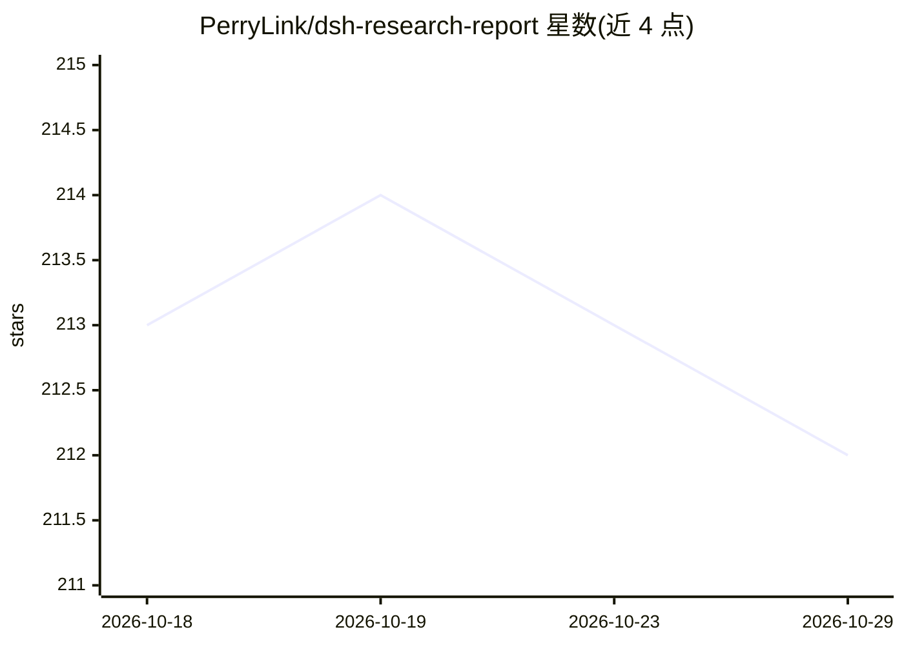

# PerryLink/dsh-research-report

⭐ 212 · TypeScript · Apache-2.0 · 推送 2026-10-27 · [GitHub](https://github.com/PerryLink/dsh-research-report) · [官网](https://perrylink.github.io/plugins/dsh-research-report/) · 个人维护 · 中文 README

**DeepSeek Harness 插件：生成逐条声明可验证的密封研究报告**

面向 DeepSeek Harness 的研究报告引擎插件：以内容寻址的证据账本（SHA-256 对象存储 + JSONL 日志）登记不可变证据快照，将报告中每条声明与证据绑定并做字节级核验，产出带 manifest 哈希密封的版本化报告（report.md + manifest.json + verification.jsonl + disconfirmation.jsonl）。判定分 verified/unverified/insufficient/disproven/contradicted 五级，不依赖语义或嵌入。另带独立验证 CLI（dsh-research-verify，支持 JSON/SARIF 输出）与零网络零模型的复算回环。规划与综合仍归模型或上游插件，不做检索编排。

## 筛选速览

| 维度 | 判定 | 备注 |
|---|---|---|
| AI 角色 | `ai-ecosystem` | LLM/agent 周边工具 |
| 许可风险 | `permissive` | Apache-2.0 |
| 部署形态 | `library` | 以包/库形式分发 |
| 模型依赖 | locked-api |  |
| 硬件要求 | — | 无带数字的原话,不猜 |
| 安装摩擦 | `low` | 无编译、无系统依赖或容器化 |
| 成熟度 | — | 结构信号不足 |

## 能力要点

- 声明↔证据绑定与逐字面字节级核验（五级判定，无嵌入）
- manifest 哈希密封的版本化报告，任何人可复算
- 证伪账本与按内容哈希记忆的负面知识（同一文本对同一证据强制回 disproven）
- 独立验证 CLI dsh-research-verify 支持 JSON/SARIF 2.1.0 输出

## 适用场景

- 让 AI agent 产出的研究报告附每条声明的核验判定与可见标记
- 事后离线复算密封报告哈希，检测证据篡改或缺失
- 跨 sibling 插件经冻结服务面 ctx.researchReport.assemble 复用报告组装

## 场景标签

`科研工具` · 领域:学习与行业

## 证据(README 行号)

> L7: **A verifiable research-report engine for DeepSeek Harness.**
> L44: ## What is dsh-research-report?
> L82: dsh plugin --profile web add github:PerryLink/dsh-research-report

## 星数曲线

2026-10-18 213 → 2026-10-29 212（-1）

---
*卡片 v1 · prompt 1.4 · 生成 2026-10-22 · 置信度 high · 依据 README sha `ab2daa400340` · [字段定义](../../DATASET.md)*
