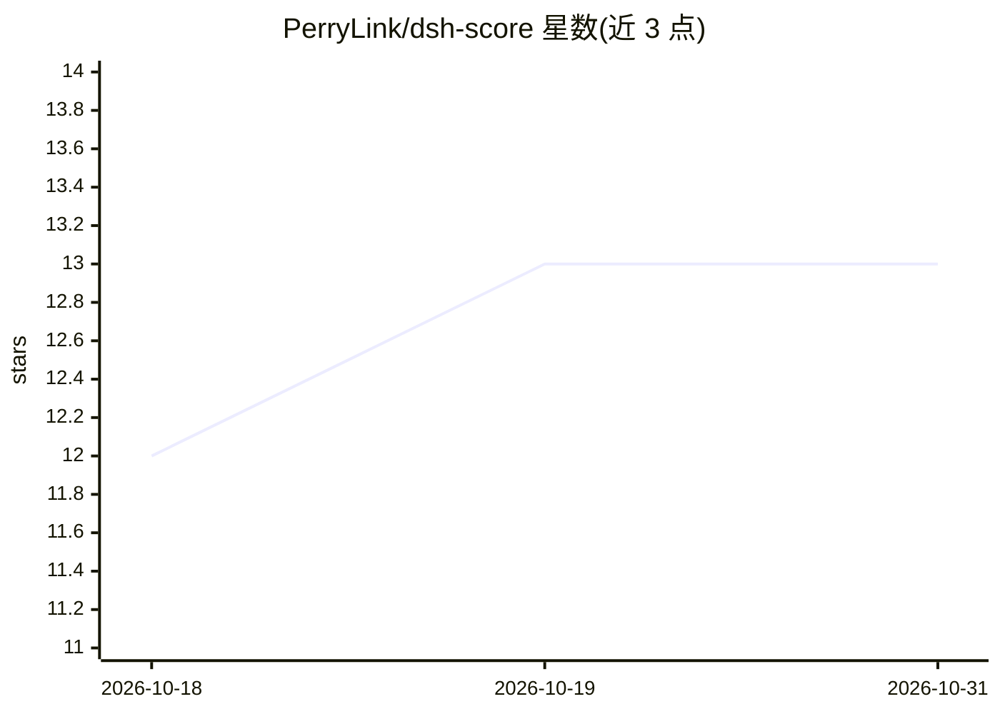

# PerryLink/dsh-score

⭐ 13 · TypeScript · Apache-2.0 · 推送 2026-10-24 · [GitHub](https://github.com/PerryLink/dsh-score) · [官网](https://perrylink.github.io/plugins/dsh-score/) · 个人维护 · 中文 README

**为 DeepSeek Harness 插件做多维质量评分的 DSH 插件**

DeepSeek Harness 平台的插件，面向 DSH 插件生态做质量评分：对 GitHub 仓库或 npm 包按五个维度（安装成功、维护活跃、文档完整、安全扫描、协议合规）加权打分，输出风险卡、排行榜与可嵌入徽章。证据来自 gh/npm CLI 探测，无证据的维度记为 no-evidence（0 分且不计入加权），不编造数字；安装成功维度消费 dsh-test-drive 的结果。运行需 gh（已认证）与 npm CLI 在 PATH 上，不执行目标代码。通过 dsh plugin 命令或 npm 渠道安装。

## 筛选速览

| 维度 | 判定 | 备注 |
|---|---|---|
| AI 角色 | `ai-ecosystem` | LLM/agent 周边工具 |
| 许可风险 | `permissive` | Apache-2.0 |
| 部署形态 | `library` | 以包/库形式分发 |
| 模型依赖 | locked-api |  |
| 硬件要求 | — | 无带数字的原话,不猜 |
| 安装摩擦 | `low` | 无编译、无系统依赖或容器化 |
| 成熟度 | — | 结构信号不足 |

## 能力要点

- 五维加权评分（默认 install 25 / maintenance 20 / documentation 20 / security 20 / compliance 15）
- 每个维度记录审计链接（source/detail/observedAt），无证据即 no-evidence 而非编造分数
- score/score_report/score_badge 工具与 /score 批量后台任务，产出排行榜快照（JSON+Markdown）
- 生成可嵌入 README 的 shields.io 徽章与五维 JSON（schema: dsh-score/v1）

## 适用场景

- 安装 DSH 插件前评估其质量与风险等级（A–F）
- 批量给候选插件打分并生成排行榜对比
- 在插件 README 中嵌入质量徽章

## 场景标签

 · 领域:AI agent 插件生态/评测

## 证据(README 行号)

> L7: **Multi-dimensional quality scoring for DeepSeek Harness plugins.**
> L44: Multi-dimensional quality scoring for DeepSeek Harness plugins.
> L68: - `score` tool — one target through the five-dimension pipeline; returns the structured risk card, or `{ kind: 'bac

## 星数曲线

2026-10-18 12 → 2026-10-31 13（+1）

---
*卡片 v1 · prompt 1.4 · 生成 2026-10-31 · 置信度 high · 依据 README sha `53807db951f9` · [字段定义](../../DATASET.md)*
