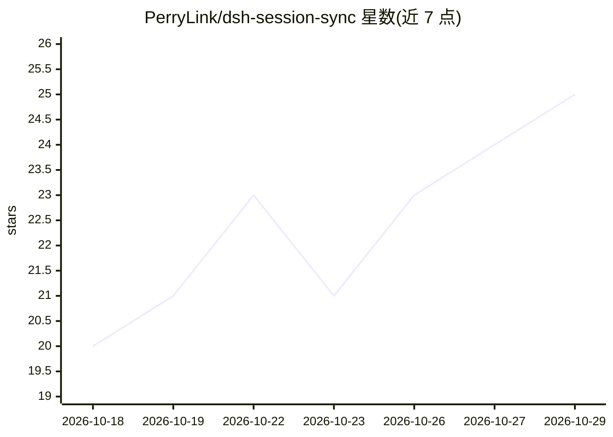

# PerryLink/dsh-session-sync

⭐ 25 · JavaScript · Apache-2.0 · 推送 2026-10-26 · [GitHub](https://github.com/PerryLink/dsh-session-sync) · [官网](https://perrylink.github.io/plugins/dsh-session-sync/) · 个人维护 · 中文 README

**DSH 会话的跨设备 git 同步插件：冲突时双方保留**

DeepSeek Harness（DSH）插件，将会话存储镜像到用户自控的专用 git 仓库实现跨设备同步：提供 /sync 命令与 sync_* 工具（status/diff/log/pull/push），变更操作经确认门控。核心机制是仅追加的三方合并——出现分歧时本地保留、远端保存为 fork 文件，从不静默覆盖，git 不 force-push/rebase。支持启动拉取、回合结束推送等自动模式，可选 age 加密后端加密远端镜像内容。需 DSH 环境与 git。

## 筛选速览

| 维度 | 判定 | 备注 |
|---|---|---|
| AI 角色 | `ai-ecosystem` | LLM/agent 周边工具 |
| 许可风险 | `permissive` | Apache-2.0 |
| 部署形态 | `library` | 以包/库形式分发 |
| 模型依赖 | locked-api |  |
| 硬件要求 | — | 无带数字的原话,不猜 |
| 安装摩擦 | `low` | 无编译、无系统依赖或容器化 |
| 成熟度 | — | 结构信号不足 |

## 能力要点

- /sync 命令与 sync_pull/sync_push 工具，读写分离且写操作经确认门控
- 仅追加冲突解决：分歧双方都保留（fork 文件），从不静默覆盖
- 同步到用户自控的 git 远端，无云服务、不存凭证，输出脱敏
- 可选 age 加密后端保护远端镜像内容

## 适用场景

- 在多台设备间同步我的 DSH 会话记录
- 冲突时不想丢任何一边的对话回合
- 把会话镜像到私有 git 仓库且内容加密

## 场景标签

 · 领域:AI Agent 基础设施/同步工具

## 证据(README 行号)

> L7: **Cross-device session sync for DeepSeek Harness — a dedicated git mirror of your session store.**
> L65: `dsh-session-sync` mirrors your DSH session store into a dedicated git worktree and syncs it to a remote **you** co
> L68: - **`sync_status` / `sync_pull` / `sync_push` tools** — the same surface for the model, inside a turn.

## 星数曲线

2026-10-18 20 → 2026-10-29 25（+5）

---
*卡片 v1 · prompt 1.4 · 生成 2026-10-27 · 置信度 high · 依据 README sha `672977faa919` · [字段定义](../../DATASET.md)*
