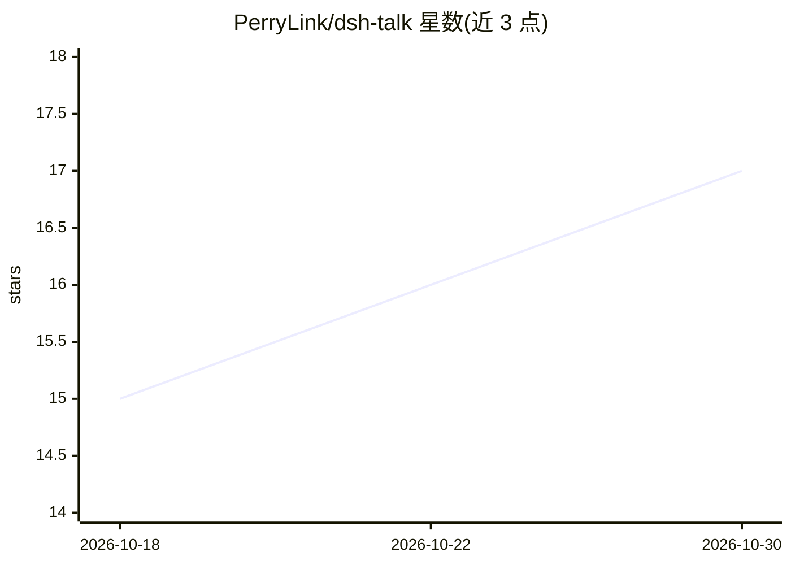

# PerryLink/dsh-talk

⭐ 17 · TypeScript · Apache-2.0 · 推送 2026-10-27 · [GitHub](https://github.com/PerryLink/dsh-talk) · [官网](https://perrylink.github.io/plugins/dsh-talk/) · 个人维护 · 中文 README

**DeepSeek Harness 的语音会话插件：说话输入、语音答复**

面向 DeepSeek Harness（dsh）的语音交互插件，构建双向语音回路：输入框麦克风按钮录制语音并转写为草稿或直接提交（STT 引擎可选 Web Speech、FunASR HTTP 服务、本地 whisper.cpp），agent 通过 speak 工具朗读回复（TTS 可选浏览器语音、edge-tts、本地 piper），本地合成的音频可导出文件供其他工具消费。另提供事件语音播报（回合结束/待审批/错误，带静音开关）与说话打断播放。通过 dsh plugin 命令经 git/npm/tarball 三种渠道安装，要求 Node ^22.19.0 || >=24.0.0。

## 筛选速览

| 维度 | 判定 | 备注 |
|---|---|---|
| AI 角色 | `ai-ecosystem` | LLM/agent 周边工具 |
| 许可风险 | `permissive` | Apache-2.0 |
| 部署形态 | `library` | 以包/库形式分发 |
| 模型依赖 | — | README 未给出锁定关系 |
| 硬件要求 | — | 无带数字的原话,不猜 |
| 安装摩擦 | `low` | 无编译、无系统依赖或容器化 |
| 成熟度 | — | 结构信号不足 |

## 能力要点

- 双向语音回路：麦克风转写输入（Web Speech/FunASR/whisper.cpp）+ speak 工具语音回复（浏览器/edge-tts/piper）
- 说话即打断当前播放（talk/interrupt 远程命名空间）
- 事件语音播报（回合结束/待审批/错误）带静音开关与可配置短语
- 本地合成音频导出至 home 下专用目录（数量/时长双上限自动清理），audioPath 可传给其他工具

## 适用场景

- 在与 DeepSeek Harness 的会话中用语音代替打字输入
- 让 agent 用语音朗读回复并实现免手操作的对话流程
- 语音播报回合完成或审批提醒，配合说话打断播放

## 场景标签

`语音合成` `语音识别` · 领域:内容生成

## 证据(README 行号)

> L7: **Voice-first session loop for DeepSeek Harness: talk to it, hear it answer.**
> L46: Voice-first session loop for DeepSeek Harness: talk to it, hear it answer.
> L66: - **`speak` tool** — the agent speaks its replies aloud. TTS engines: the browser voice, `edge-tts` (network neural

## 星数曲线

2026-10-18 15 → 2026-10-30 17（+2）

---
*卡片 v1 · prompt 1.4 · 生成 2026-10-30 · 置信度 high · 依据 README sha `d60de9cad9dc` · [字段定义](../../DATASET.md)*
