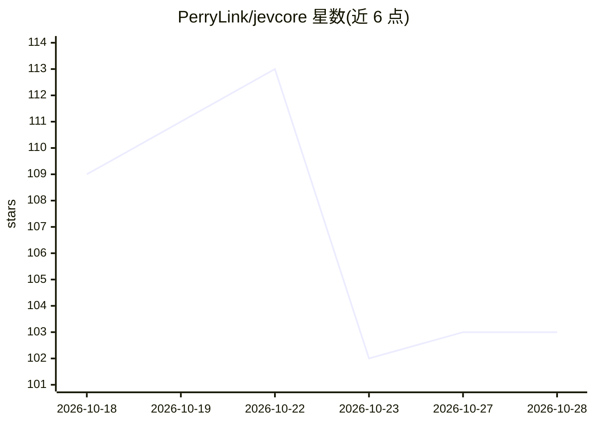

# PerryLink/jevcore

⭐ 103 · TypeScript · Apache-2.0 · 推送 2026-10-18 · [GitHub](https://github.com/PerryLink/jevcore) · [官网](https://www.npmjs.com/package/jevcore) · 个人维护 · 中文 README

**给 agent 的类型化决策工具：Jev 是非/选择/评分判断与校准概率**

面向 DeepSeek Harness、任意 MCP 宿主与普通 Node 的三个包（jevcore 核心、jevcore-dsh 插件、jevcore-mcp 服务器），提供 jev_ask/jev_rank/jev_check 三个工具，让 agent 获取类型化答案（noul/choice/score）与校准概率而非散文。默认离线 mock provider，零网络调用；live 路径经 TypeSafe 或 OpenRouter，需显式配置密钥，出站内容逐特性声明并经敏感字段与密钥形状两轮脱敏。安全与上下文两个 gate 默认关闭、需显式开启。运行需 Node（dsh 包要求 ^22.19.0||>=24，其余 >=20）。

## 筛选速览

| 维度 | 判定 | 备注 |
|---|---|---|
| AI 角色 | `ai-ecosystem` | LLM/agent 周边工具 |
| 许可风险 | `permissive` | Apache-2.0 |
| 部署形态 | `library` | 以包/库形式分发 |
| 模型依赖 | locked-api |  |
| 硬件要求 | — | 无带数字的原话,不猜 |
| 安装摩擦 | `low` | 无编译、无系统依赖或容器化 |
| 成熟度 | — | 结构信号不足 |

## 能力要点

- 三个工具返回类型化答案与校准概率，拒绝散文输出
- 默认离线 mock provider，live 路径需显式密钥，出站逐特性声明
- 两轮脱敏（敏感字段名+密钥形状）与模型不可自行放宽约束的设计
- 同一核心以 DSH 插件、MCP stdio 服务器、纯 Node 库三种形式提供

## 适用场景

- 在 DeepSeek Harness 中给 agent 增加类型化判断工具
- 通过 MCP 在非 DSH 宿主中使用相同决策工具
- 在路由/门控场景以低成本决策替代模型往返

## 场景标签

`Agent 框架` · 领域:Agent 开发

## 证据(README 行号)

> L8: TypeSafe Jev for DeepSeek Harness
> L29: |`jevcore`|The decisions. Imports nothing from DeepSeek Harness or Cordis.|You want Jev in a plain script, a servic
> L31: |`jevcore-mcp`|The same three tools over MCP, with a stdio binary|Your host speaks MCP but is not DSH|

## 星数曲线

2026-10-18 109 → 2026-10-28 103（-6）

---
*卡片 v1 · prompt 1.4 · 生成 2026-10-23 · 置信度 high · 依据 README sha `70760af9447d` · [字段定义](../../DATASET.md)*
