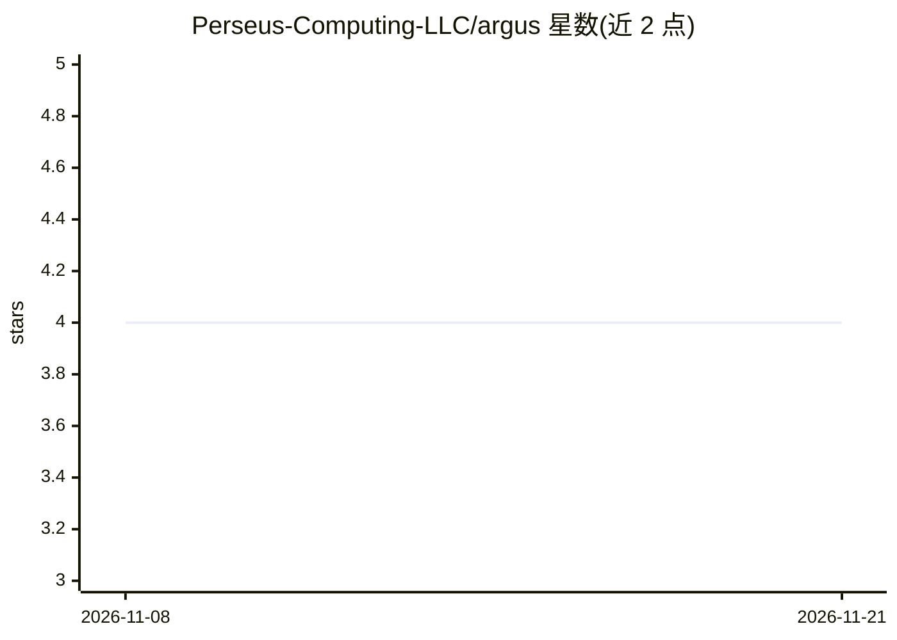

# Perseus-Computing-LLC/argus

⭐ 4 · Python · MIT · 推送 2026-11-17 · [GitHub](https://github.com/Perseus-Computing-LLC/argus) · [官网](https://telarch.ai/argus) · 组织维护

**为 AI agent 行为生成防篡改审计账本：SHA-256 哈希链记录**

Argus 是一个记录 AI agent 行为的防篡改账本库：将每个操作追加到线性 SHA-256 哈希链，验证时报告第一个被篡改事件的序号；配合存放在外部的锚点（最新序列号与哈希）可检测整个历史被重写、回滚或截断的情况。提供 Rust crate（FileLedger/InMemoryLedger）与 Python 包（AppendOnlyLedger），可选 HMAC-SHA256 或 Ed25519 签名，本地 JSONL 存储、无网络代码。Python 版依赖 fcntl，仅运行于 Linux/macOS。当前为 0.1.0-alpha 预发布，API 与格式可能变动。

## 筛选速览

| 维度 | 判定 | 备注 |
|---|---|---|
| AI 角色 | `ai-ecosystem` | LLM/agent 周边工具 |
| 许可风险 | `permissive` | MIT |
| 部署形态 | `library` | 以包/库形式分发 |
| 模型依赖 | — | README 未给出锁定关系 |
| 硬件要求 | — | 无带数字的原话,不猜 |
| 安装摩擦 | `low` | 无编译、无系统依赖或容器化 |
| 成熟度 | `idea` | |

## 能力要点

- 线性 SHA-256 哈希链，验证报告首个被篡改事件的序号
- 外部锚点可检测从头重写/回滚/截断的历史
- 可选 HMAC-SHA256 或 Ed25519 每事件签名
- 提供 Rust 与 Python 双实现，本地 JSONL 存储、无网络代码

## 适用场景

- 为执行命令、调用 API、编辑文件的 agent 保留可验证操作日志
- 合规或安全审计中定位日志被篡改的位置
- 以外部锚点检测审计历史是否被整体重写

## 场景标签

`网络安全` `LLM 可观测性` · 领域:评测与运维

## 证据(README 行号)

> L3: **A record of what your agent did that shows if anyone changed it.** Argus appends every action to a linear SHA-256 
> L13: Agents run commands, call APIs and edit files. Afterwards the log is the only account of what happened, and an ordi
> L9: Argus is one of the three Telarch libraries from Perseus Computing LLC. Harpe decides what goes into each model call

## 星数曲线

2026-11-08 4 → 2026-11-21 4（+0）

---
*卡片 v1 · prompt 1.4 · 生成 2026-11-21 · 置信度 high · 依据 README sha `9d6ee74c366b` · [字段定义](../../DATASET.md)*
