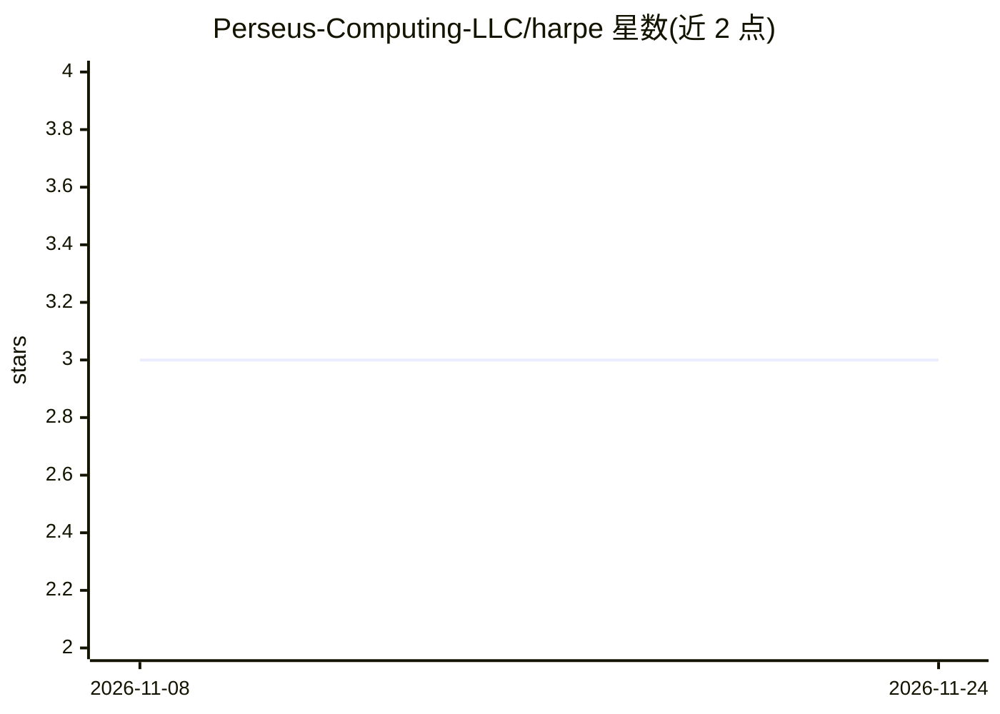

# Perseus-Computing-LLC/harpe

⭐ — · [GitHub]() · 组织维护

**为 AI agent 在 token 预算内选择每次调用的上下文项**

Rust/Python 双语言库（同仓 crate 与 pip 包），在 token 预算内决定哪些上下文条目进入每次模型调用：置顶与优先级 0 条目始终保留，其余按优先级或时间新近度贪心装入；提供 KNAPSACK_DP 精确 0/1 背包策略、Rust 版 TokenBudget 预留答案/工具调用余量、合成报告（保留/丢弃/剩余 token）、可插拔 TokenCounter、机密条目过滤与相对日期改写。同一输入产出相同选择（默认策略无随机、无时钟）。无网络代码，Rust crate 无依赖。当前为 0.1.0 alpha 预发布，API 可能变动。

## 筛选速览

| 维度 | 判定 | 备注 |
|---|---|---|
| AI 角色 | `ai-ecosystem` | LLM/agent 周边工具 |
| 许可风险 | `permissive` | — |
| 部署形态 | `library` | 以包/库形式分发 |
| 模型依赖 | — | README 未给出锁定关系 |
| 硬件要求 | — | 无带数字的原话,不猜 |
| 安装摩擦 | `low` | 无编译、无系统依赖或容器化 |
| 成熟度 | `idea` | |

## 能力要点

- 置顶/优先级条目保底，超支时报告 over_budget 并支持 strict 报错
- Python KNAPSACK_DP 精确 0/1 背包（5M cells 上限），可选 harpe_native Rust 加速
- 确定性选择：reference_time 取最新条目而非墙钟，同输入同输出
- 可插拔 tokenizer（含 TiktokenCounter），默认无 token 估算可用

## 适用场景

- agent 上下文超出模型窗口时按预算裁剪且可审计
- 每次调用前判定历史能否整段直送模型还是需检索裁剪
- 远程调用前过滤标记为机密的上下文条目
- 为记忆中的对话回合标注日历日期便于模型定位时间

## 场景标签

`Agent 记忆` · 领域:Agent 开发

## 证据(README 行号)

> L3: **Choose what goes into each model call, under a token budget.** Harpe picks which context items go into each call: 
> L13: Agents collect instructions, memory, documents and tool output faster than a model can read them. Sending everythin

## 星数曲线

2026-11-08 3 → 2026-11-24 3（+0）

---
*卡片 v1 · prompt 1.4 · 生成 2026-11-22 · 置信度 high · 依据 README sha `08a92a356544` · [字段定义](../../DATASET.md)*
