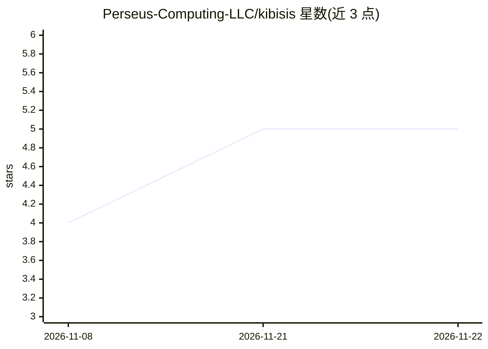

# Perseus-Computing-LLC/kibisis

⭐ 5 · Python · MIT · 推送 2026-11-21 · [GitHub](https://github.com/Perseus-Computing-LLC/kibisis) · [官网](https://telarch.ai/kibisis) · 组织维护

**给 AI agent 提供本地加密记忆的库与 MCP 服务器**

Kibisis 是 Perseus Computing LLC 的 Telarch 三库之一，为 agent 提供本地记忆存储：Python 端用 AES-256-GCM 封存条目于单个 SQLite 文件，可选 SQLCipher 全库加密；每条记忆带 candidate/verified/disputed/revoked 信任状态与有效期，tombstone 删除可阻止重写，全部变更记录于哈希链账本，租约用递增 fencing token 保证单写者。通过 stdio MCP 服务器暴露 remember/recall/forget 等工具，agent 写入内容默认为候选态，需人工经多账户 quorum 审核后才成 verified。默认不发起出站网络连接。提供 Python 包与 Rust crate，README 注明当前为 0.1.0-alpha 预发布版本。

## 筛选速览

| 维度 | 判定 | 备注 |
|---|---|---|
| AI 角色 | `ai-ecosystem` | LLM/agent 周边工具 |
| 许可风险 | `permissive` | MIT |
| 部署形态 | `library` | 以包/库形式分发 |
| 模型依赖 | — | README 未给出锁定关系 |
| 硬件要求 | — | 无带数字的原话,不猜 |
| 安装摩擦 | `low` | 无编译、无系统依赖或容器化 |
| 成熟度 | `idea` | |

## 能力要点

- 记忆以 AES-256-GCM 加密落盘，可选 SQLCipher 整文件加密
- 信任状态（candidate/verified/disputed/revoked）与按日期回溯查询
- 哈希链变更账本与带 fencing token 的单写者租约
- stdio MCP 服务器接入 agent，写入内容默认为候选态待人工审核

## 适用场景

- 让本地运行的 agent 跨会话记住决策与偏好，数据不出本机
- 需要人工审核 agent 记忆写入内容的团队流程
- 多进程写同一记忆库时防止并发写入冲突
- 需要可验证审计记录的 agent 记忆场景

## 场景标签

`Agent 记忆` · 领域:Agent 开发

## 证据(README 行号)

> L3: **Local, encrypted memory for AI agents.** Kibisis keeps what an agent learns on your own machine, decides what come
> L24: - **Ready for agents.** An MCP server over stdio offers remember, recall, forget, verify-ledger and health tools. I
> L10: Kibisis is one of the three Telarch libraries from Perseus Computing LLC. Harpe decides what goes into each model c

## 星数曲线

2026-11-08 4 → 2026-11-22 5（+1）

---
*卡片 v1 · prompt 1.4 · 生成 2026-11-21 · 置信度 high · 依据 README sha `abd691e7c036` · [字段定义](../../DATASET.md)*
