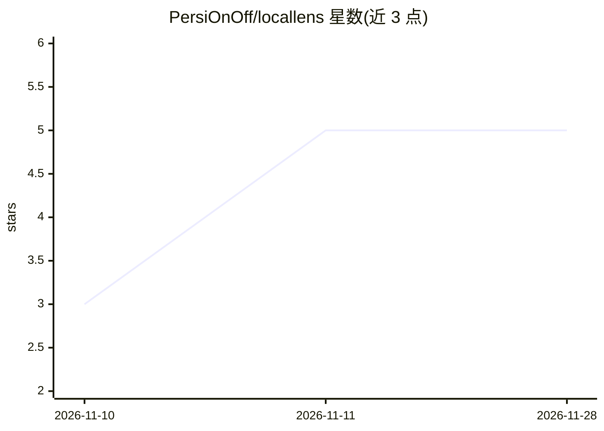

# PersiOnOff/locallens

⭐ 5 · TypeScript · MIT · 推送 2026-11-14 · [GitHub](https://github.com/PersiOnOff/locallens) · 个人维护

**自托管的本地文档/代码 RAG 问答工作区，带引用溯源**

LocalLens 是一个面向个人文档与代码库的自托管 AI 工作区：上传 PDF/Markdown/文本后本地切分、经 Ollama 生成嵌入存入 SQLite，问答时做精确余弦检索，答案附带可点击的来源片段（PDF 页码或行号），并提供解析相对 import 与 Markdown 链接的文件关系图。Docker Compose 一键启动，默认 CPU 可用；定位为无认证的单用户本地工具，不适合公网部署，扫描版 PDF 需先行 OCR。

## 筛选速览

| 维度 | 判定 | 备注 |
|---|---|---|
| AI 角色 | `ai-native` | 本体是模型或模型工具 |
| 许可风险 | `permissive` | MIT |
| 部署形态 | `self-host` | docker 或自建部署 |
| 模型依赖 | local-ok | 支持本地模型 |
| 硬件要求 | — | 无带数字的原话,不猜 |
| 安装摩擦 | `low` | 无编译、无系统依赖或容器化 |
| 成熟度 | — | 结构信号不足 |

## 能力要点

- 本地 RAG 问答，答案附来源片段与 PDF 页码/行号引用
- 文件关系图：解析相对 import 与 Markdown 链接
- SQLite 存储 chunks 与向量，索引中断后可续跑
- 默认仅绑定 127.0.0.1，无遥测，Ollama 云功能禁用

## 适用场景

- 在本地向自己的 PDF 与笔记提问并核验出处
- 导入代码仓库浏览 import 依赖关系图
- 对隐私敏感文档做不上云的检索问答

## 场景标签

`RAG` `文档问答` · 领域:知识与检索

## 证据(README 行号)

> L10: **Ask your private documents. Follow the evidence. Keep inference on your machine.**
> L75: - **Local inference.** Embeddings and answers run through Ollama. No cloud provider or telemetry is configured.
> L113: Text is split into overlapping chunks (1,400 characters, 200-character overlap). PDF chunks retain their page numb

## 星数曲线

2026-11-10 3 → 2026-11-28 5（+2）

---
*卡片 v1 · prompt 1.4 · 生成 2026-11-21 · 置信度 high · 依据 README sha `e166c8e87c8d` · [字段定义](../../DATASET.md)*
