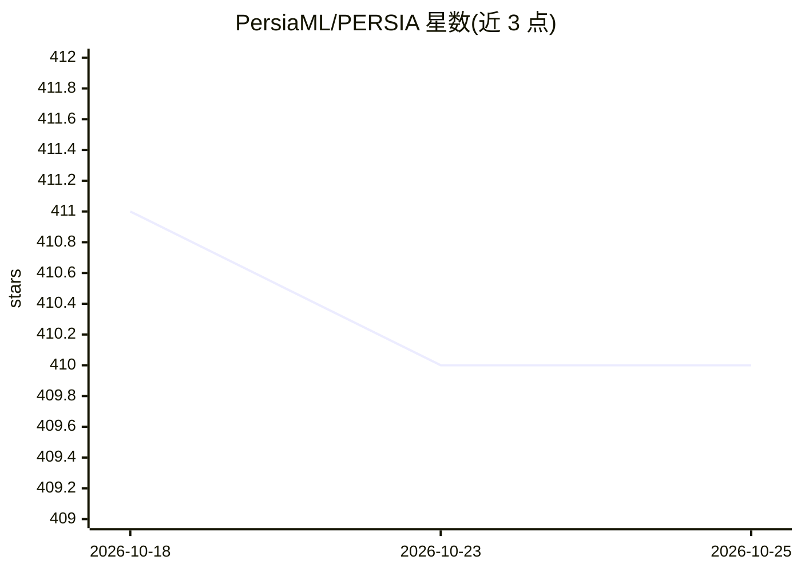

# PersiaML/PERSIA

⭐ 410 · Rust · MIT · 推送 2026-10-23 · [GitHub](https://github.com/PersiaML/PERSIA) · 组织维护 · 中文 README

**训练万亿至百万亿参数推荐模型的 PyTorch 分布式框架**

由快手 AI 平台与 ETH 合作开发的分布式深度学习推荐模型训练系统，基于 PyTorch，面向商用硬件上的大规模训练，声称可训练最高 100 万亿参数的推荐模型。采用 Rust 编写的组件（仓库主题含 rust-lang），在快手亿级 DAU 业务中应用过。项目由公司维护，但 README 明确声明因公司重组目前不再维护；官方英文文档仍不完整。以 PyPI 包与 Docker 镜像形式提供。

## 筛选速览

| 维度 | 判定 | 备注 |
|---|---|---|
| AI 角色 | `ai-ecosystem` | LLM/agent 周边工具 |
| 许可风险 | `permissive` | MIT |
| 部署形态 | `self-host` | docker 或自建部署 |
| 模型依赖 | — | README 未给出锁定关系 |
| 硬件要求 | — | 无带数字的原话,不猜 |
| 安装摩擦 | `low` | 无编译、无系统依赖或容器化 |
| 成熟度 | `idea` | |

## 能力要点

- 支持最高 100 万亿参数的推荐模型训练
- 基于 PyTorch 的混合加速分布式训练系统
- PyPI 包与 Docker 镜像分发

## 适用场景

- 在商用硬件集群上训练超大规模推荐模型
- 工业界推荐系统研发团队的大规模训练实验

## 场景标签

`推荐系统` `模型训练` · 领域:学习与行业

## 证据(README 行号)

> L14: **PERSIA** (**P**arallel r**E**commendation t**R**aining **S**ystem with hybr**I**d **A**cceleration) is developed 
> L12: *WARNING: THIS PROJECT IS CURRENTLY NOT MAINTAINED, DUE TO COMPANY REORGANIZATION.*

## 星数曲线

2026-10-18 411 → 2026-10-25 410（-1）

---
*卡片 v1 · prompt 1.4 · 生成 2026-10-21 · 置信度 high · 依据 README sha `a477823256d6` · [字段定义](../../DATASET.md)*
