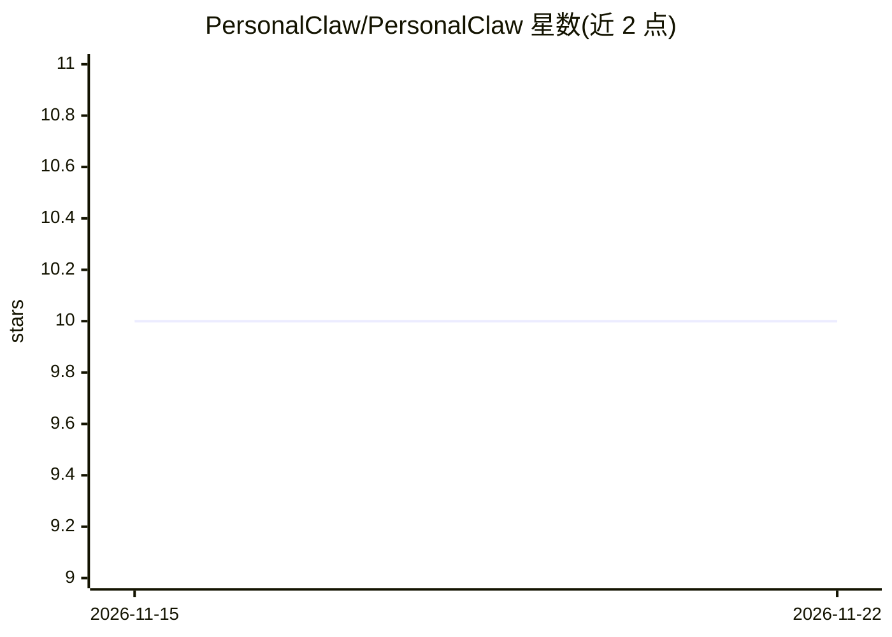

# PersonalClaw/PersonalClaw

⭐ 10 · Python · MIT · 推送 2026-11-21 · [GitHub](https://github.com/PersonalClaw/PersonalClaw) · [官网](https://personalclaw.dev) · 组织维护

**自托管单用户 AI agent 平台：聊天、记忆、知识库与自动化**

自托管的个人 AI agent 运行环境，聚合多会话工具调用聊天、目标自动循环、分层记忆、知识库摄取（PDF/DOCX/PPTX/HTML）、SKILL.md 技能市场、定时/ webhook 自动化与 MCP 双向连接。所有供应商（模型、搜索、语音、通道）均以可卸载应用形式经 Store 安装，状态集中在本机 ~/.personalclaw。当前为 v0.3.9 pre-1.0，0.x 升级可能破坏兼容且无自动迁移，仅支持单用户，无原生 Windows 安装。

## 筛选速览

| 维度 | 判定 | 备注 |
|---|---|---|
| AI 角色 | `ai-ecosystem` | LLM/agent 周边工具 |
| 许可风险 | `permissive` | MIT |
| 部署形态 | `self-host` | docker 或自建部署 |
| 模型依赖 | local-ok | 支持本地模型 |
| 硬件要求 | — | 无带数字的原话,不猜 |
| 安装摩擦 | `low` | 无编译、无系统依赖或容器化 |
| 成熟度 | `idea` | |

## 能力要点

- 目标自动循环：分类、规划并在可暂停的确定性监督下逐周期执行
- 分层语义/情景/程序记忆，含纠正后学习与 Obsidian 兼容 vault
- MCP 双向：可连出任意 MCP 服务器，并对外暴露六个只读工具
- 权限门控应用平台：quarantine→scan→consent 安装流程与 HMAC 安全日志

## 适用场景

- 把个人任务交给 agent 自主循环推进
- 在本机构建带引用的知识库问答
- 通过 cron/webhook 让 agent 监听通道并起草回复

## 场景标签

`AI 助手` `RAG` `文档问答` · 领域:对话与助手

## 证据(README 行号)

> L5: **Your self-hosted personal AI agent — an agentic operating system for one person.**
> L61: PersonalClaw runs AI agents that accomplish *your* work with a rich, user-assembled set
> L63: runtimes — is a **removable app**, so nothing ties you to a single LLM vendor or service.

## 星数曲线

2026-11-15 10 → 2026-11-22 10（+0）

---
*卡片 v1 · prompt 1.4 · 生成 2026-11-20 · 置信度 high · 依据 README sha `9ac57634eb03` · [字段定义](../../DATASET.md)*
