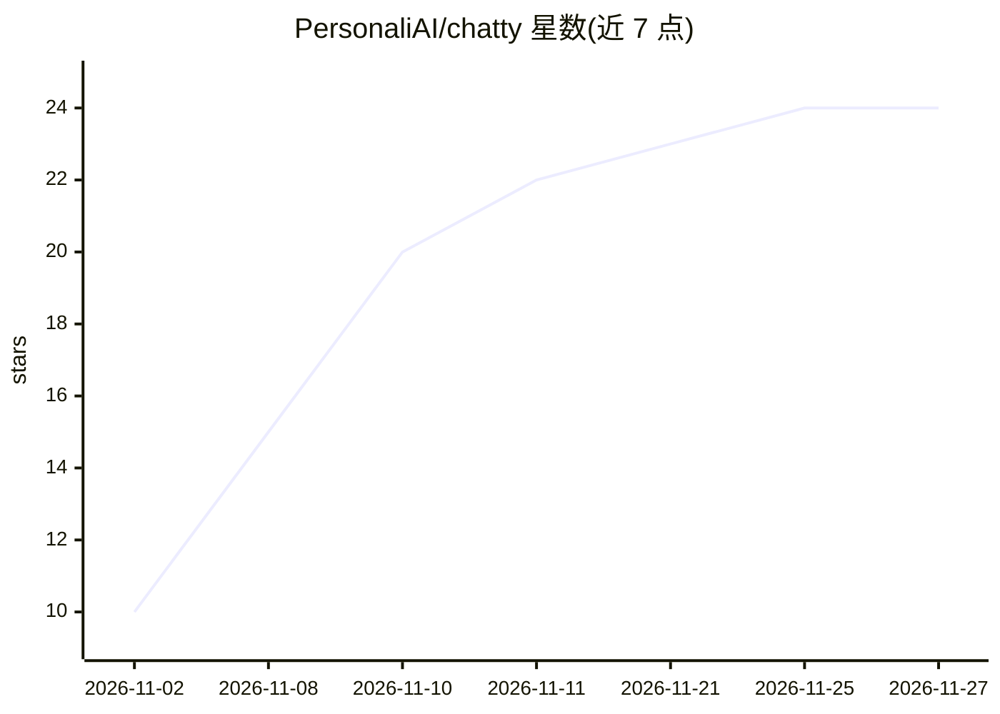

# PersonaliAI/chatty

⭐ 24 · TypeScript · MIT · 推送 2026-11-22 · [GitHub](https://github.com/PersonaliAI/chatty) · [官网](https://chatty.personaliai.com) · 组织维护 · 中文 README

**面向商店与企业的开源 AI 客服平台，Zendesk/Intercom 替代**

自托管的开源 AI 客服系统：基于店铺与自有文档训练的 AI agent 回答客户问题、捕获线索、预约会议，渠道覆盖网站 Widget、WhatsApp、Slack 等 7 通道。核心机制包括 pgvector/HNSW 混合检索的 Multimodal RAG、WooCommerce 同步、LiveKit WebRTC 实时语音、可视化 Flow Builder，以及 81 工具的 FastMCP 服务器（OAuth 2.0/API Key）供 Claude Desktop、Cursor 等调用。LLM 通过 BYOK 接入（默认免费档 Gemini，可选 OpenAI/Anthropic/Groq/本地模型），支持 docker compose 一键自托管，MIT 许可，另有 Chatty Cloud 托管版（14 天试用）。

## 筛选速览

| 维度 | 判定 | 备注 |
|---|---|---|
| AI 角色 | `ai-native` | 本体是模型或模型工具 |
| 许可风险 | `permissive` | MIT |
| 部署形态 | `self-host` | docker 或自建部署 |
| 模型依赖 | — | README 未给出锁定关系 |
| 硬件要求 | — | 无带数字的原话,不猜 |
| 安装摩擦 | `low` | 无编译、无系统依赖或容器化 |
| 成熟度 | — | 结构信号不足 |

## 能力要点

- 7 通道全渠道客服（WhatsApp/Messenger/Instagram/TikTok/Telegram/SMS/邮件）与一键人工接管
- pgvector + HNSW 混合检索的 Multimodal RAG 与 WooCommerce 店铺同步
- 81 工具 FastMCP 服务器，可供 Claude Desktop/Cursor/Codex 程序化操控面板
- BYOK 多模型接入（默认免费 Gemini，支持 OpenAI/Anthropic/Groq/本地模型）

## 适用场景

- 为电商店铺搭建自托管的 AI 客服，替代按席位计费的 SaaS
- 让 AI agent 全天候回答客户问题并在需要时转人工
- 通过 MCP 让外部 AI 工具操控客服面板与工作流

## 场景标签

`聊天机器人` `语音 Agent` · 领域:对话与助手

## 证据(README 行号)

> L10: ### Open-source AI agent trained on your store and content. Answers customer questions, captures leads, and books m
> L21: Chatty is an open-source, self-hostable **Zendesk and Intercom alternative** for stores and modern businesses that 
> L46: Every hosted chatbot SaaS charges per-seat or per-message and holds your conversation data. Chatty is open-core: ru

## 星数曲线

2026-11-02 10 → 2026-11-27 24（+14）

---
*卡片 v1 · prompt 1.4 · 生成 2026-11-18 · 置信度 mid · 依据 README sha `987af2b669a8` · [字段定义](../../DATASET.md)*
