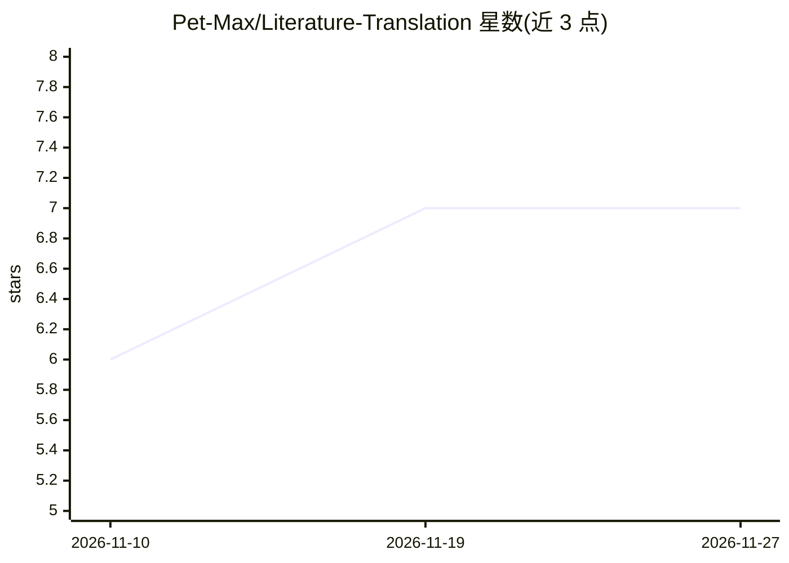

# Pet-Max/Literature-Translation

⭐ 7 · Go · MIT · 推送 2026-11-25 · [GitHub](https://github.com/Pet-Max/Literature-Translation) · 个人维护 · 中文 README

**面向科研用户的英文学术文献 PDF/MD 中文翻译桌面应用**

用 Go 与 Wails v2 构建的 Windows 桌面应用：拖入英文 PDF/MD 后经 MinerU 解析、文本层校准修复解析损伤，调用用户自配的 OpenAI 兼容 LLM 完成翻译，公式冻结原样保留，导出含公式、表格与参考文献的中文 PDF，并附双语对照。提供分片并行、断点续跑、术语表与双预设规则、逐篇文献归档。需 MinerU API Token 与 LLM Key；仅支持 Windows 10/11，另提供共用管线的 CLI。

## 筛选速览

| 维度 | 判定 | 备注 |
|---|---|---|
| AI 角色 | `ai-native` | 本体是模型或模型工具 |
| 许可风险 | `permissive` | MIT |
| 部署形态 | `desktop` | 安装包/桌面程序 |
| 模型依赖 | — | README 未给出锁定关系 |
| 硬件要求 | — | 无带数字的原话,不猜 |
| 安装摩擦 | `low` | 无编译、无系统依赖或容器化 |
| 成熟度 | — | 结构信号不足 |

## 能力要点

- 按语言自动分流：英文 PDF 全流程、英文 MD 直接翻译、中文 MD 仅导出
- 以原 PDF 文本层为参照的解析校准，公式冻结零损伤并机械校验重试
- 断点续跑与文献归档：每篇保留原文 PDF/英文 MD/中文 MD/成品 PDF 四类产物
- GUI 与 CLI 共用同一 internal/pipeline 管线，CLI 提供 check/run/translate/print/calibrate/font 子命令

## 适用场景

- 把英文论文整篇翻成带公式的中文 PDF
- 中英对照核对译文段落
- 批量入队多份文献串行翻译并断点续跑

## 场景标签

`科研工具` `文档解析` · 领域:知识与检索

## 证据(README 行号)

> L7:  英文学术文献翻译桌面应用 —— PDF / MD 拖入即翻，产出带公式、图表、参考文献的中文 PDF
> L25: - **智能路由**：按语言自动分流——英文 PDF 全流程、英文 MD 直接翻译、中文 MD 仅导出、中文 PDF 秒拒
> L57: |任意 OpenAI 兼容 LLM|模型 API 地址 + API Key + 模型名|

## 星数曲线

2026-11-10 6 → 2026-11-27 7（+1）

---
*卡片 v1 · prompt 1.4 · 生成 2026-11-20 · 置信度 high · 依据 README sha `a6b463b591f3` · [字段定义](../../DATASET.md)*
