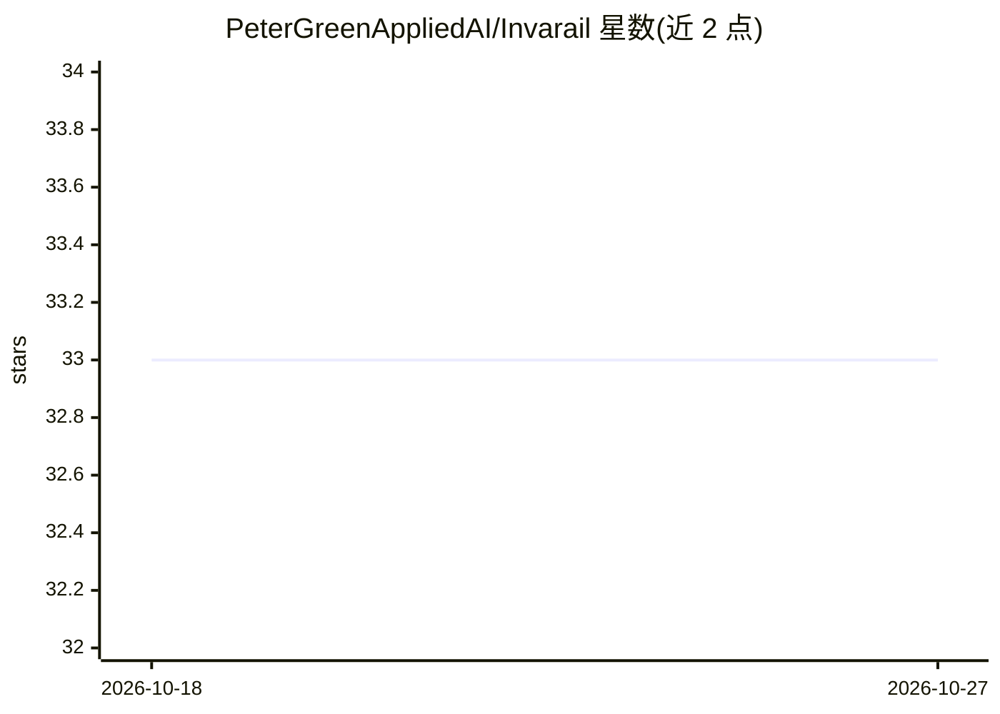

# PeterGreenAppliedAI/Invarail

⭐ 33 · TypeScript · MIT · 推送 2026-10-18 · [GitHub](https://github.com/PeterGreenAppliedAI/Invarail) · 个人维护

**自托管本地 AI agent 框架：7-30B 模型驱动、权限治理层**

面向自托管场景的 agent 系统，完全运行在用户自己的硬件上，无云端 API。架构分层：权限平面（目标绑定授权、确认账本、审计轨迹，agent 无法从内部修改）+ 日常使用层（带图记忆的聊天、经验证的研究报告、图像生成，经 Discord/Telegram/Gmail/web/Chrome 适配器）+ 可替换 worker（Pi 编码 agent、FlowMCP 流程、受治理的 ReAct 循环）。针对 7-30B 小模型采用路由+专家、代码级安全门、管道验证等结构化机制，并发布可复现评测（41 种模型配置、1,234 测试）。仅支持单用户 LAN 部署形态，macOS/Linux 从源码运行，Windows 未正式支持安装。

## 筛选速览

| 维度 | 判定 | 备注 |
|---|---|---|
| AI 角色 | `ai-ecosystem` | LLM/agent 周边工具 |
| 许可风险 | `permissive` | MIT |
| 部署形态 | `library` | 以包/库形式分发 |
| 模型依赖 | local-ok | 支持本地模型 |
| 硬件要求 | — | 无带数字的原话,不猜 |
| 安装摩擦 | `low` | 无编译、无系统依赖或容器化 |
| 成熟度 | — | 结构信号不足 |

## 能力要点

- 权限平面：六层过滤器与确认账本在模型介入前以代码强制执行
- 针对 7-30B 小模型的路由+专家架构与 41 配置公开评测
- FalkorDB 图记忆（SUPERSEDES 边、逐条溯源）与自校验研究管线
- npm run setup 向导自动探测 Node/Ollama/Docker/FalkorDB 等依赖

## 适用场景

- 在自己的 GPU 上跑一个可聊天、做研究、写代码的私人 agent
- 需要权限治理与审计的本地 agent 部署
- 在无外发数据的前提下生成经验证的研究报告

## 场景标签

`Agent 框架` `图像生成` `科研工具` · 领域:Agent 开发

## 证据(README 行号)

> L15: Invarail runs entirely on your own hardware: no cloud APIs, no per-token costs, no data leaving your machines. It i
> L17: - **An authority plane** — permissions, target-bound grants, a confirmation ledger, audit trails, and tool exposure
> L19: - **A host for interchangeable workers** — coding runs through the Pi agent, repeatable procedures through FlowMCP 
> L21: Built for small local models (7-30B), where every failure is legible the same evening — which is exactly how this a

## 星数曲线

2026-10-18 33 → 2026-10-27 33（+0）

---
*卡片 v1 · prompt 1.4 · 生成 2026-10-26 · 置信度 high · 依据 README sha `3d4c10875aa5` · [字段定义](../../DATASET.md)*
