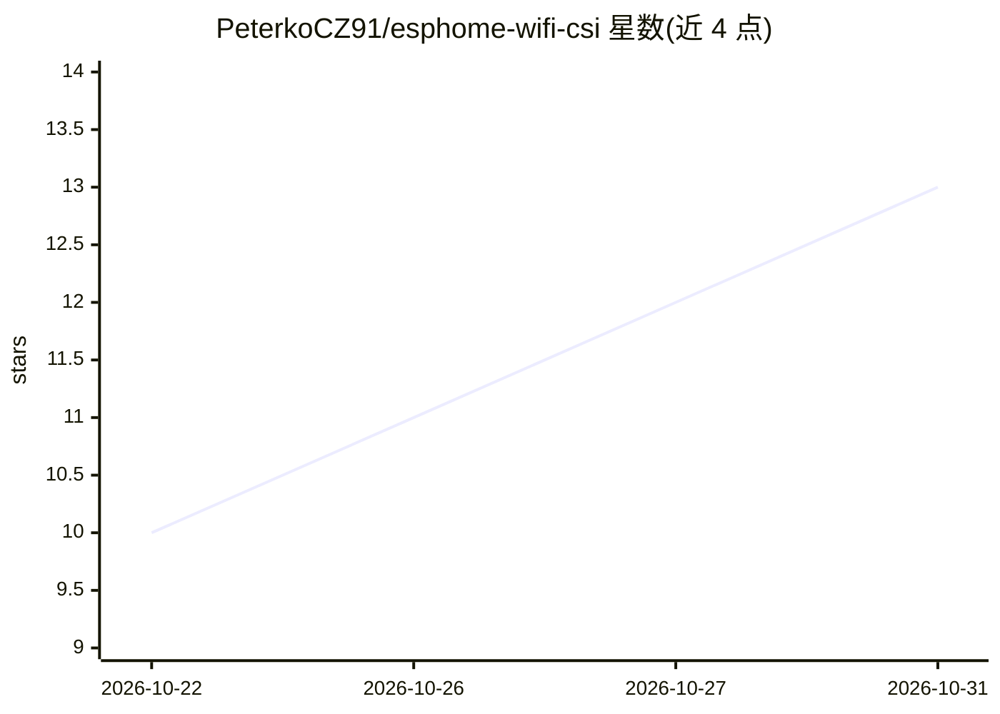

# PeterkoCZ91/esphome-wifi-csi

⭐ 13 · C++ · GPL-3.0 · 推送 2026-10-27 · [GitHub](https://github.com/PeterkoCZ91/esphome-wifi-csi) · 个人维护

**基于 WiFi CSI 的 ESP32 人体存在/呼吸检测 ESPHome 组件**

ESPectre 的 ESPHome 外部组件分支，在 ESP32（C3/C5/C6/S3/经典款）上利用 WiFi 信道状态信息实现人体存在、运动与呼吸频率检测。支持单节点（读取路由器信标 CSI）、双节点成对感知（ESP-NOW/UDP TX，最高 5 个 TX 对端）、3-4 节点网格，并配备 Docker+SQLite 数据采集工具与 scikit-learn 多节点 ML 融合服务（45 特征 MLP，交叉验证 F1=0.833）。呼吸率经 DFT 估计 6-30 BPM。板载 ML 权重标注为实验性，默认推荐 mvs 检测器；ESP32-C5 的 5 GHz 模式未随本版本验证。

## 筛选速览

| 维度 | 判定 | 备注 |
|---|---|---|
| AI 角色 | `ai-native` | 本体是模型或模型工具 |
| 许可风险 | `viral` | GPL-3.0 |
| 部署形态 | `self-host` | docker 或自建部署 |
| 模型依赖 | — | README 未给出锁定关系 |
| 硬件要求 | — | 无带数字的原话,不猜 |
| 安装摩擦 | `low` | 无编译、无系统依赖或容器化 |
| 成熟度 | `idea` | |

## 能力要点

- WiFi CSI 单节点存在检测与 DFT 呼吸率估计（6-30 BPM）
- 成对感知与多节点网格（peer_macs 支持至多 5 个 TX 对端）
- 多节点 ML 融合服务：45 特征 MLP，交叉验证 F1=0.833
- Docker+SQLite 标注数据采集工具链

## 适用场景

- 用 ESP32 开发板给家庭做非摄像头的人体存在与呼吸检测
- 通过 MQTT 接入 Home Assistant 等家庭自动化系统
- 采集标注 CSI 数据并训练房间级坐/走/空分类器

## 场景标签

 · 领域:智能家居/嵌入式感知

## 证据(README 行号)

> L6: > ESPHome external component for human presence detection using WiFi Channel State Information (CSI) on ESP32.
> L78: Multiple RX nodes around a room. 45-feature ML classifier distinguishes sitting, walking, and empty with cross-vali
> L291: |Multi-node fusion|`ml_inference_service.py` (MQTT)|15 features per node × 3 RX nodes = 45|MLP 45→32→16→1 (scikit-

## 星数曲线

2026-10-22 10 → 2026-10-31 13（+3）

---
*卡片 v1 · prompt 1.4 · 生成 2026-10-31 · 置信度 mid · 依据 README sha `c8f527ef1d78` · [字段定义](../../DATASET.md)*
