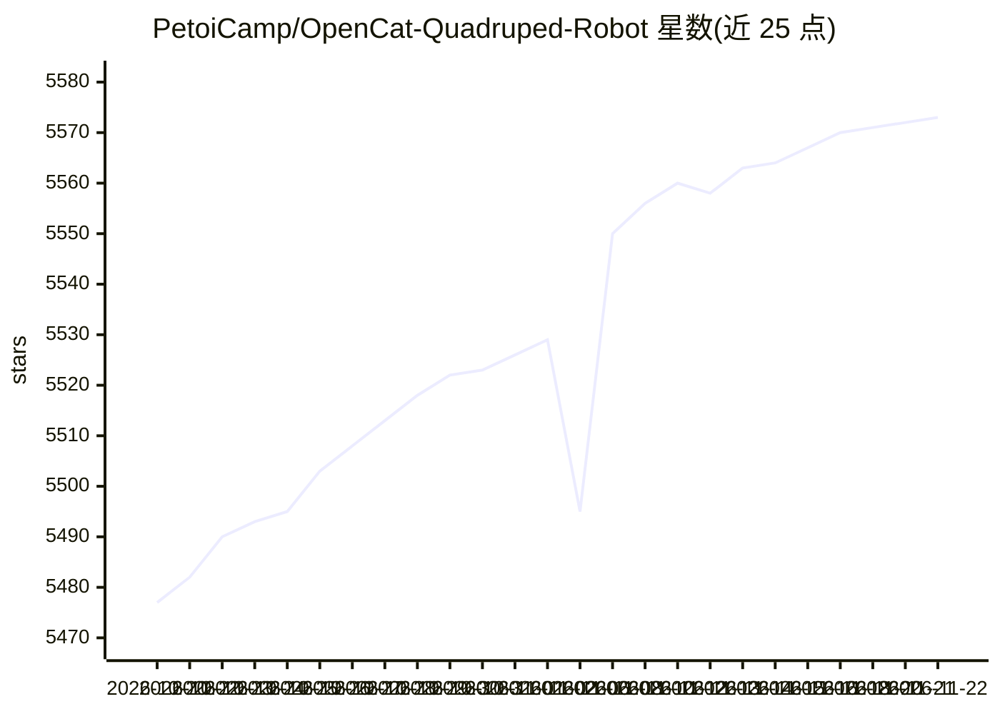

# PetoiCamp/OpenCat-Quadruped-Robot

⭐ 5,573 · C++ · MIT · 推送 2026-11-18 · [GitHub](https://github.com/PetoiCamp/OpenCat-Quadruped-Robot) · [官网](https://www.petoi.com) · 组织维护

**开源四足机器人框架，供教育/研究/DIY 编程与构建**

Petoi 开发的 Arduino + Raspberry Pi 四足机器人框架，是 Bittle 机器狗与 Nybble 机器猫套件的底层固件，针对 NyBoard（ATmega328P）主控板。框架处理步态协调、舵机控制、IMU 集成，支持 C/C++、Python 与积木式编程，可扩展摄像头、超声波等传感器，并兼容 ROS 管线。安装流程为 clone 仓库后在 Arduino IDE 中编译上传固件，经串口进行 IMU 与关节校准。当前代硬件（Bittle X、Nybble Q）已迁移至 OpenCatESP32 仓库，本仓库覆盖旧款 NyBoard 平台。

## 筛选速览

| 维度 | 判定 | 备注 |
|---|---|---|
| AI 角色 | `ai-enhanced` | 去掉 AI 部分产品仍成立 |
| 许可风险 | `permissive` | MIT |
| 部署形态 | `None` |  |
| 模型依赖 | — | README 未给出锁定关系 |
| 硬件要求 | — | 无带数字的原话,不猜 |
| 安装摩擦 | `low` | 无编译、无系统依赖或容器化 |
| 成熟度 | — | 结构信号不足 |

## 能力要点

- 处理步态协调、舵机控制与 IMU 集成的四足机器人固件框架
- 支持 C/C++、Python 与积木式编程，兼容 ROS
- 支持强化学习 sim-to-real 实验，可外接 Raspberry Pi/Jetson Nano 等 AI 协处理器
- 面向 K-12 到大学实验室的机器人编程教学场景

## 适用场景

- 搭建并编程自己的四足机器狗/机器猫
- 在真实机器人上跑强化学习与 sim-toreal 实验
- K-12 或大学机器人/STEM 课程教学
- 基于传感器扩展做物体检测、SLAM 等 DIY 项目

## 场景标签

`强化学习` · 领域:训练与推理

## 证据(README 行号)

> L7: OpenCat is an open-source Arduino and Raspberry Pi-based framework for building and programming quadruped robots. De
> L9: The framework handles the hard parts — gait coordination, servo control, IMU integration — so you can focus on what 
> L166: OpenCat shows up in **AI robotics education** across K-12 programs, community colleges, university labs, and maker

## 星数曲线

2026-10-20 5,477 → 2026-11-22 5,573（+96）

---
*卡片 v1 · prompt 1.4 · 生成 2026-11-22 · 置信度 high · 依据 README sha `c57370c78595` · [字段定义](../../DATASET.md)*
