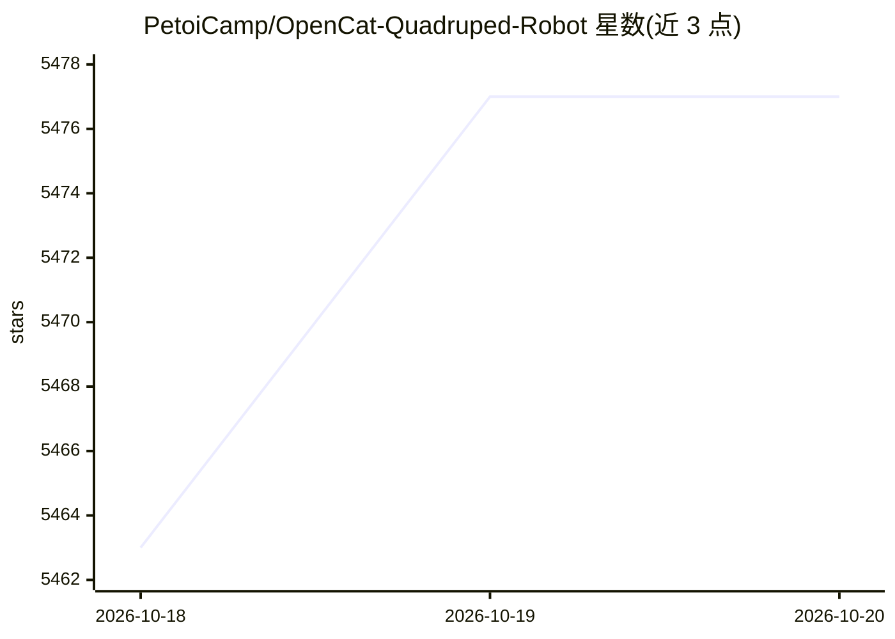

# PetoiCamp/OpenCat-Quadruped-Robot

⭐ 5,477 · C++ · MIT · 推送 2026-09-08 · [GitHub](https://github.com/PetoiCamp/OpenCat-Quadruped-Robot) · [官网](https://www.petoi.com) · 组织维护

**开源四足机器人框架：给教育者/研究者/DIY 者构建机器宠物**

Petoi 维护的 Arduino/Raspberry Pi 四足机器人开源框架，驱动 Bittle 机器狗与 Nybble 机器猫。框架处理步态协调、舵机控制与 IMU 集成，支持 C/C++、Python 与积木编程，可外接摄像头、树莓派、Jetson Nano 等 AI 协处理器，支持强化学习 sim-to-real 实验与 ROS 兼容。本仓库面向旧款 NyBoard（ATmega328P）平台，已归档不再维护；现款 ESP32 硬件见 OpenCatESP32。适用于 K-12 教育、大学实验室与创客项目。

## 筛选速览

| 维度 | 判定 | 备注 |
|---|---|---|
| AI 角色 | `ai-enhanced` | 去掉 AI 部分产品仍成立 |
| 许可风险 | `permissive` | MIT |
| 部署形态 | `None` |  |
| 模型依赖 | — | README 未给出锁定关系 |
| 硬件要求 | — | 无带数字的原话,不猜 |
| 安装摩擦 | `low` | 无编译、无系统依赖或容器化 |
| 成熟度 | — | 结构信号不足 |

## 能力要点

- 步态协调、最多 12 舵机控制与 IMU 集成的固件框架
- 多语言编程支持：C/C++、Python、积木编程
- 可外接树莓派/Jetson Nano 等 AI 协处理器，支持强化学习 sim-to-real
- ROS 兼容，社区有 SLAM 与导航流水线文档

## 适用场景

- 课堂上教机器人编程与物理 AI
- 在廉价四足平台上做强化学习 sim-to-real 实验
- DIY 3D 打印定制机器宠物
- 科研实验室的具身机器人实验载体

## 场景标签

 · 领域:机器人/教育

## 证据(README 行号)

> L7: OpenCat is an open-source Arduino and Raspberry Pi-based framework for building and programming quadruped robots. De
> L9: The framework handles the hard parts — gait coordination, servo control, IMU integration — so you can focus on what 
> L53: - **Arduino + Raspberry Pi native:** works with the tools you already use

## 星数曲线

2026-10-18 5,463 → 2026-10-20 5,477（+14）

---
*卡片 v1 · prompt 1.4 · 生成 2026-10-20 · 置信度 high · 依据 README sha `39464d276237` · [字段定义](../../DATASET.md)*
