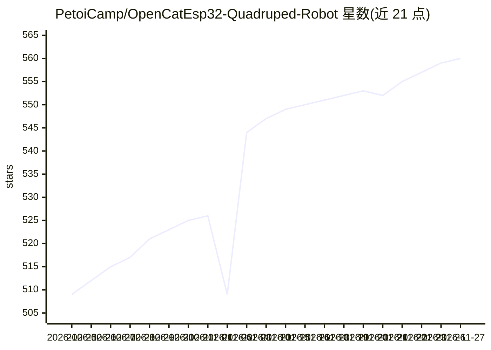

# PetoiCamp/OpenCatEsp32-Quadruped-Robot

⭐ 560 · C++ · MIT · 推送 2026-11-23 · [GitHub](https://github.com/PetoiCamp/OpenCatEsp32-Quadruped-Robot) · [官网](https://www.petoi.com) · 组织维护

**面向 STEM 教育与机器狗研究的 ESP32 四足机器人开源框架**

Petoi 开发的四足机器人宠物固件框架，运行于 ESP32 开发板 BiBoard，支持最多 12 路舵机的多自由度腿式机器人；官方硬件包括 Bittle X 机器狗与 Nybble Q 机器猫套件，均带语音控制。支持 Arduino IDE 烧录与图形化积木编程，可用于步态研究、强化学习与 sim2real 实验、ROS/树莓派扩展、K-12 到大学实验室的机器人教学。旧 NyBoard（ATmega328P）版本已停售，新机型 Quaddle 源码尚未公开。

## 筛选速览

| 维度 | 判定 | 备注 |
|---|---|---|
| AI 角色 | `ai-enhanced` | 去掉 AI 部分产品仍成立 |
| 许可风险 | `permissive` | MIT |
| 部署形态 | `None` |  |
| 模型依赖 | — | README 未给出锁定关系 |
| 硬件要求 | — | 无带数字的原话,不猜 |
| 安装摩擦 | `low` | 无编译、无系统依赖或容器化 |
| 成熟度 | — | 结构信号不足 |

## 能力要点

- 运行于 ESP32 双核 240MHz BiBoard，支持最多 12 舵机 12-DOF 配置
- 内置 Wi-Fi 与蓝牙，可无线控制与数据流传输
- 兼容 Arduino IDE 工作流，软硬件均开源可 fork
- 平台被 14 篇学术论文引用，支持步态/强化学习/sim2real 研究

## 适用场景

- 搭建开源四足机器人做步态与强化学习研究
- 在 K-12 到大学课程中开展实体 AI 机器人教学
- 配合树莓派与 ROS 做视觉、SLAM 等扩展项目

## 场景标签

`强化学习` · 领域:训练与推理

## 证据(README 行号)

> L5: OpenCatESP32 runs the OpenCat quadruped robotics framework on BiBoard — an ESP32-based development board designed fo
> L22: - Same open platform this repo already supports for gait research, reinforcement learning (RL), and sim2real work —
> L92: OpenCat shows up in **AI robotics education** across K-12 programs, community colleges, university labs, and maker 

## 星数曲线

2026-10-25 509 → 2026-11-27 560（+51）

---
*卡片 v1 · prompt 1.4 · 生成 2026-11-25 · 置信度 high · 依据 README sha `9a9376eaa90d` · [字段定义](../../DATASET.md)*
