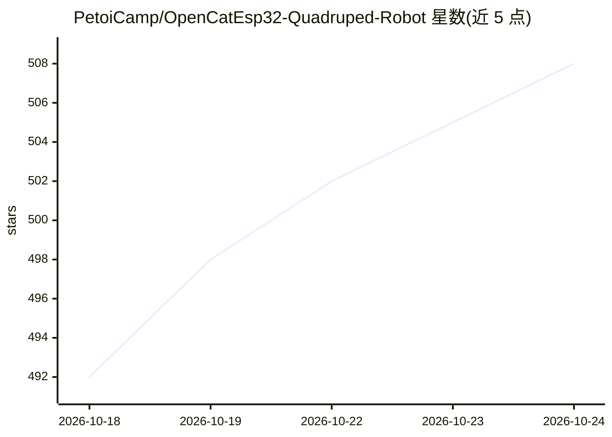

# PetoiCamp/OpenCatEsp32-Quadruped-Robot

⭐ 508 · C++ · MIT · 推送 2026-09-08 · [GitHub](https://github.com/PetoiCamp/OpenCatEsp32-Quadruped-Robot) · 组织维护

**ESP32 四足机器宠物的开源框架，面向教育、研究与DIY**

Petoi 维护的 OpenCat 四足机器人框架在 ESP32/BiBoard 上的代码库：BiBoard 控制板支持最多 12 舵机、双核 240 MHz、内置 Wi-Fi/蓝牙，兼容 Arduino IDE。用于 Bittle X（机器狗）与 Nybble Q（机器猫）硬件，旧 NyBoard 已停产。README 记录社区在视觉应用、树莓派机器人、ROS/SLAM、NVIDIA Isaac 仿真与强化学习、sim2real 等方向的使用，并覆盖 K-12 到大学实验室的 AI 机器人教育场景。另宣布 2026 年 9 月在 Kickstarter 上线 4 舵机新四足 Quaddle，其源码暂未公开。

## 筛选速览

| 维度 | 判定 | 备注 |
|---|---|---|
| AI 角色 | `ai-enhanced` | 去掉 AI 部分产品仍成立 |
| 许可风险 | `permissive` | MIT |
| 部署形态 | `None` |  |
| 模型依赖 | — | README 未给出锁定关系 |
| 硬件要求 | — | 无带数字的原话,不猜 |
| 安装摩擦 | `low` | 无编译、无系统依赖或容器化 |
| 成熟度 | `idea` | |

## 能力要点

- BiBoard（ESP32 双核 240 MHz）支持最多 12 舵机的 12 自由度构型
- 提供 Arduino IDE（ESP32 Dev Module）完整烧录配置表
- 同一平台支持步态研究、强化学习与 sim2real 实验
- 旧 NyBoard（ATmega328P）机型已停产，BiBoard 为当前平台

## 适用场景

- 在 Bittle X / Nybble Q 上做步态与强化学习研究
- K-12 到大学的机器人与 AI 教学
- 结合树莓派/ROS 做视觉、SLAM 等扩展项目
- DIY 改装与 3D 打印外壳定制

## 场景标签

`强化学习` · 领域:训练与推理

## 证据(README 行号)

> L5: OpenCatESP32 runs the OpenCat quadruped robotics framework on BiBoard — an ESP32-based development board designed fo
> L22: - Same open platform this repo already supports for gait research, reinforcement learning (RL), and sim2real work —
> L63: If you're building an open source robot dog for research, running ROS, deploying a vision model, or just want room 

## 星数曲线

2026-10-18 492 → 2026-10-24 508（+16）

---
*卡片 v1 · prompt 1.4 · 生成 2026-10-21 · 置信度 mid · 依据 README sha `390df26f69fd` · [字段定义](../../DATASET.md)*
