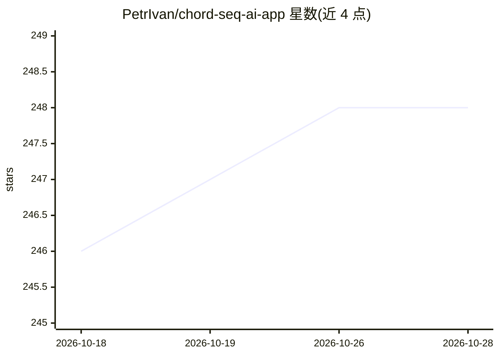

# PetrIvan/chord-seq-ai-app

⭐ 248 · TypeScript · MIT · 推送 2026-10-20 · [GitHub](https://github.com/PetrIvan/chord-seq-ai-app) · [官网](https://chordseqai.com) · 个人维护

**面向作曲者的网页版和弦进行 AI 建议工具**

基于 Next.js 14 的网页应用：用户在时间线上输入和弦序列，内置深度学习模型（循环网络与 Transformer S/M/L 及条件 Transformer）建议下一个和弦，条件模型可按流派和年代加权生成。模型经 ONNX Runtime 在浏览器本地运行，无需上传数据。功能包括播放、节拍器、变调、MIDI 导入导出与和弦变体选择，序列上限 255 个和弦。本地运行需 Node.js 与 git，亦有部署版 chordseqai.com。

## 筛选速览

| 维度 | 判定 | 备注 |
|---|---|---|
| AI 角色 | `ai-native` | 本体是模型或模型工具 |
| 许可风险 | `permissive` | MIT |
| 部署形态 | `library` | 以包/库形式分发 |
| 模型依赖 | — | README 未给出锁定关系 |
| 硬件要求 | — | 无带数字的原话,不猜 |
| 安装摩擦 | `low` | 无编译、无系统依赖或容器化 |
| 成熟度 | — | 结构信号不足 |

## 能力要点

- 多种模型可选（Recurrent、Transformer S/M/L、条件 Transformer）
- 模型经 ONNX Runtime 在浏览器本地推理，数据不上传
- 条件 Transformer 可按多种流派/年代加权生成建议
- 支持 MIDI 导入导出、变调、播放与节拍器

## 适用场景

- 作曲时获得下一个和弦的候选建议
- 按指定流派和年代风格生成和弦进行
- 将和弦进行导出为 MIDI 到 DAW 继续制作

## 场景标签

 · 领域:音乐创作/AI 工具

## 证据(README 行号)

> L7: The ChordSeqAI Web App is a dynamic and user-friendly interface for interactions with deep learning models. This Nex
> L127: This is a Next.js 14 app. Tailwind CSS is used as the library for styling, Zustand serves as the state management 

## 星数曲线

2026-10-18 246 → 2026-10-28 248（+2）

---
*卡片 v1 · prompt 1.4 · 生成 2026-10-22 · 置信度 high · 依据 README sha `da4368d29237` · [字段定义](../../DATASET.md)*
