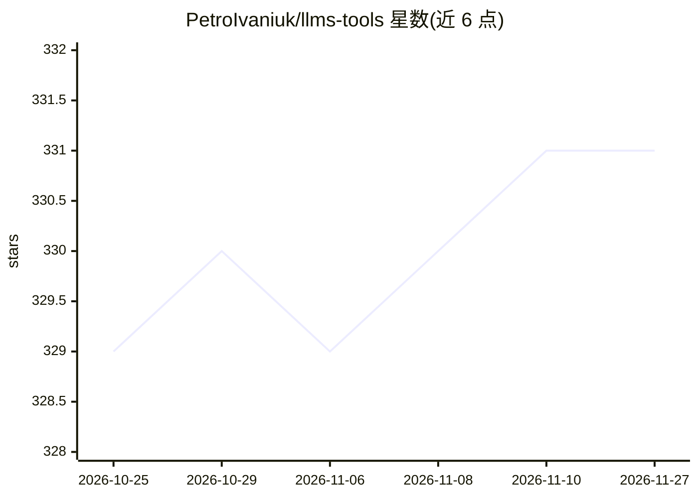

# PetroIvaniuk/llms-tools

⭐ 331 · Apache-2.0 · 推送 2026-11-10 · [GitHub](https://github.com/PetroIvaniuk/llms-tools) · 个人维护

**面向 AI 学习者的 LLM 工具与研究项目清单**

一份以清单形式组织的资源集合，收录可直接使用的 AI 工具、开源模型与研究项目，范围以 LLM 为主并延伸至计算机视觉等其他 AI 领域。内容按课程、视频、阅读材料、可视化、竞赛、模型时间线表格、开源模型列表等类别组织，另收录 2024 诺贝尔奖与 2025 图灵奖相关条目。仓库欢迎社区贡献，README 本身不含安装或运行指令。

## 筛选速览

| 维度 | 判定 | 备注 |
|---|---|---|
| AI 角色 | `ai-knowledge` | 知识聚合/清单类 |
| 许可风险 | `permissive` | Apache-2.0 |
| 部署形态 | `desktop` | 安装包/桌面程序 |
| 模型依赖 | — | README 未给出锁定关系 |
| 硬件要求 | — | 无带数字的原话,不猜 |
| 安装摩擦 | `low` | 无编译、无系统依赖或容器化 |
| 成熟度 | — | 结构信号不足 |

## 能力要点

- 按课程/视频/阅读/可视化/竞赛/模型等类别组织的资源清单
- 多厂商 LLM 与开源模型的时间线表格（2021-2026）
- 收录超出 LLM 范围的 CV 等 AI 研究项目
- 欢迎社区贡献

## 适用场景

- 查找某年度各厂商发布的 LLM 模型条目
- 系统学习 LLM 时收集课程、视频与报告资料
- 浏览开源模型以了解领域动态

## 场景标签

`精选清单` · 领域:学习与行业

## 证据(README 行号)

> L2: The repository contains a list of ready-to-use AI Tools, Open Sources, and Research Projects \
> L16: ## Large Language Models (LLMs) and Chatbots
> L56: ### Models

## 星数曲线

2026-10-25 329 → 2026-11-27 331（+2）

---
*卡片 v1 · prompt 1.4 · 生成 2026-11-25 · 置信度 mid · 依据 README sha `24f949c0e0e2` · [字段定义](../../DATASET.md)*
