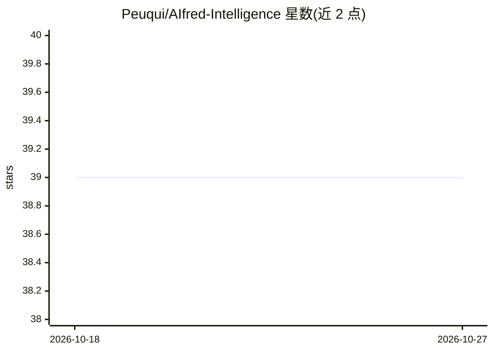

# Peuqui/AIfred-Intelligence

⭐ 39 · Python · NOASSERTION · 推送 2026-10-26 · [GitHub](https://github.com/Peuqui/AIfred-Intelligence) · [官网](https://peuqui.github.io/AIfred-Intelligence/) · 个人维护

**自托管多智能体 AI 助手：本地推理、语音、工具链与多渠道触达**

运行在用户自己硬件上的 AI 助手：多个预置智能体（AIfred/Sokrates/Salomo 等）支持五种讨论模式与子智能体委派；通过插件提供自主工具链（邮件、Google 套件、文件管理、沙箱代码执行、Web 研究、长期记忆），后端可选 llama.cpp/vLLM/Ollama 并按 VRAM 自动校准。语音能力由独立的 STT-Suite（Whisper/Parakeet）与 TTS-Suite（七个引擎、语音克隆）服务提供，另含图像分析与摄像头人脸识别监控。用户经 Web UI、Telegram、Discord、邮件或 Echo Dot 语音终端交互；框架内建权限分级与审计日志。

## 筛选速览

| 维度 | 判定 | 备注 |
|---|---|---|
| AI 角色 | `ai-native` | 本体是模型或模型工具 |
| 许可风险 | `none` | NOASSERTION |
| 部署形态 | `None` |  |
| 模型依赖 | local-ok | 支持本地模型 |
| 硬件要求 | — | 无带数字的原话,不猜 |
| 安装摩擦 | `medium` | 含编译或系统依赖之一 |
| 成熟度 | — | 结构信号不足 |

## 能力要点

- 多智能体系统：5 种讨论模式（Standard/Critical Review/Auto-Consensus/Tribunal/Symposion）与子智能体委派
- 自主工具链跨插件执行（单次请求最多 100 次工具调用），支持邮件/Google 套件/文件/沙箱代码/Web 研究
- 本地推理后端 llama.cpp、vLLM、Ollama，多 GPU 下按 VRAM 校准上下文
- TTS-Suite 七引擎与 STT-Suite（Whisper/Parakeet，Docker）提供语音、语音克隆与会议转写管线

## 适用场景

- 在自己硬件上运行可处理邮件、日程、文件与数据库的个人 AI 助手
- 通过 Telegram/Discord/语音终端在任意渠道指挥智能体完成连续任务链
- 让多个智能体辩论、评审后再给出综合结论
- 长期记忆与摄像头监控、语音交互一体化的家庭自托管部署

## 场景标签

`AI 助手` `多智能体` `语音 Agent` `人脸识别` · 领域:Agent 开发

## 证据(README 行号)

> L7: **A self-hosted AI assistant that gets things done — tool chains, sub-agents, multi-agent debates, voice, camera sur
> L9: AIfred runs on your own machine and works for you across every channel you use: it reads and answers e-mail, books a
> L17: - 🎩 **Multi-agent system** — AIfred, Sokrates, Salomo and your own agents debate, criticise, judge — or take delega

## 星数曲线

2026-10-18 39 → 2026-10-27 39（+0）

---
*卡片 v1 · prompt 1.4 · 生成 2026-10-25 · 置信度 high · 依据 README sha `477f151a95bf` · [字段定义](../../DATASET.md)*
