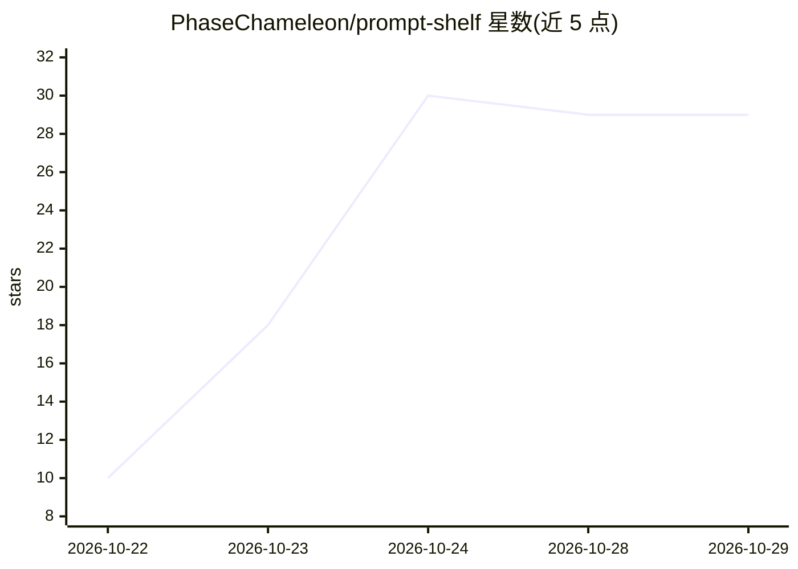

# PhaseChameleon/prompt-shelf

⭐ 29 · C# · MIT · 推送 2026-10-18 · [GitHub](https://github.com/PhaseChameleon/prompt-shelf) · 个人维护

**Windows 本地提示词库：标签、全文搜索、变量填写与一键复制**

面向 Windows 10/11 x64 的开源提示词管理桌面应用：以本地 SQLite 单文件存储提示词，提供即时全文搜索（标题/正文/标签）、颜色标签与嵌套文件夹、全局热键调色板在任意应用上方搜索并一键复制、模板变量填写对话框、JSON/Markdown 导入导出。分发为 100 MB 自包含便携 exe，离线运行、无账号无遥测，CI 构建并发布 SHA-256 校验。也可用 .NET 8 SDK 从源码构建。

## 筛选速览

| 维度 | 判定 | 备注 |
|---|---|---|
| AI 角色 | `ai-enhanced` | 去掉 AI 部分产品仍成立 |
| 许可风险 | `permissive` | MIT |
| 部署形态 | `None` |  |
| 模型依赖 | — | README 未给出锁定关系 |
| 硬件要求 | — | 无带数字的原话,不猜 |
| 安装摩擦 | `medium` | 含编译或系统依赖之一 |
| 成熟度 | — | 结构信号不足 |

## 能力要点

- 本地 SQLite 单文件存储提示词，便携随行
- 全文搜索随输入即出结果，覆盖标题/正文/标签
- 全局热键调色板：任意应用上方搜索并回车复制到剪贴板
- 模板变量填写对话框与 JSON/Markdown 双向导入导出

## 适用场景

- 我给本地 LLM 离线整理常用提示词，随时搜索一键复制
- 用变量模板快速填写不同对象/语气/长度再复制
- 把提示词库导出 JSON 迁移，不被工具锁定

## 场景标签

`提示工程` · 领域:Agent 开发

## 证据(README 行号)

> L3: 📚 Free, open-source prompt library for Windows — tags, search, variable fill-in and one-key copy. 100 MB portable, o
> L42: Pasting prompts into notes apps means they stay buried, and web managers want an account and a connection. prompt-s

## 星数曲线

2026-10-22 10 → 2026-10-29 29（+19）

---
*卡片 v1 · prompt 1.4 · 生成 2026-10-26 · 置信度 high · 依据 README sha `bc0ab9ca31f2` · [字段定义](../../DATASET.md)*
