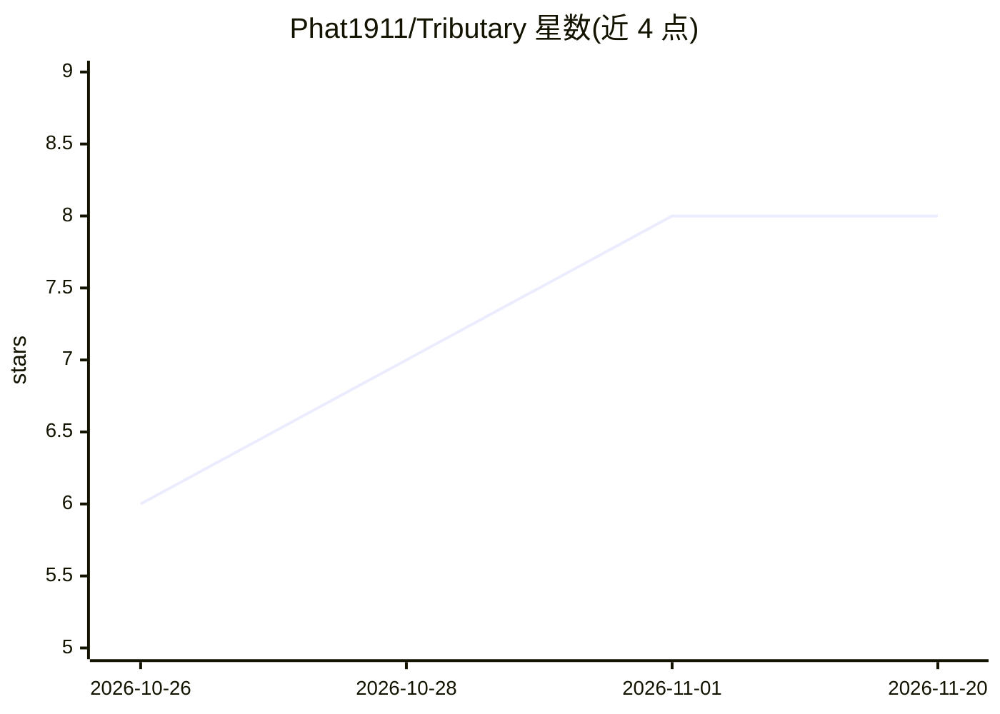

# Phat1911/Tributary

⭐ 8 · Rust · NOASSERTION · 推送 2026-11-19 · [GitHub](https://github.com/Phat1911/Tributary) · 个人维护

**团队共享 AI 额度的自托管密钥治理网关**

Rust 编写的单容器自托管 AI token 池网关：组织将 provider 密钥集中信封加密保管，向每个成员发放独立 API key，请求在网关侧做计量、配额检查、IP 指纹与跨网络共享检测，并写入数据库强制的 append-only 审计日志。所有池以 OpenAI 兼容线格式通信（含 Gemini 经兼容端点接入），不转换 API 格式。定位 V1 为免费治理工具；V2 的 Solana 结算信用市场为受协议门槛限制的路线图。源码构建约需 10–15 分钟 Rust 编译。

## 筛选速览

| 维度 | 判定 | 备注 |
|---|---|---|
| AI 角色 | `ai-ecosystem` | LLM/agent 周边工具 |
| 许可风险 | `none` | NOASSERTION |
| 部署形态 | `self-host` | docker 或自建部署 |
| 模型依赖 | — | README 未给出锁定关系 |
| 硬件要求 | — | 无带数字的原话,不猜 |
| 安装摩擦 | `low` | 无编译、无系统依赖或容器化 |
| 成熟度 | `idea` | |

## 能力要点

- 成员独立 key、配额、双网络共享检测与 append-only 审计日志
- 接受任意 OpenAI 兼容端点的密钥，Gemini 可经兼容 base URL 接入
- 密钥静态信封加密；可选 purpose classifier 默认关闭并向成员披露
- 提供 Docker 镜像与 compose 单容器部署，内置 Next.js 管理面板

## 适用场景

- 团队共享一组 AI 密钥并按成员分配配额
- 检测密钥被粘贴到群聊后的异常使用与跨国共享
- 在自有机器上托管 AI 用量网关，不经第三方路由商

## 场景标签

`模型网关` · 领域:Agent 开发

## 证据(README 行号)

> L8: **Status: v0.1.4 — self-hostable AI token pools** (gateway, org pools,
> L10: keys over pooled provider capacity, with quotas, audit, and leak
> L135: > OpenAI-routed traffic. Tributary speaks (and meters) the

## 星数曲线

2026-10-26 6 → 2026-11-20 8（+2）

---
*卡片 v1 · prompt 1.4 · 生成 2026-11-20 · 置信度 mid · 依据 README sha `e7fa4bfa1407` · [字段定义](../../DATASET.md)*
