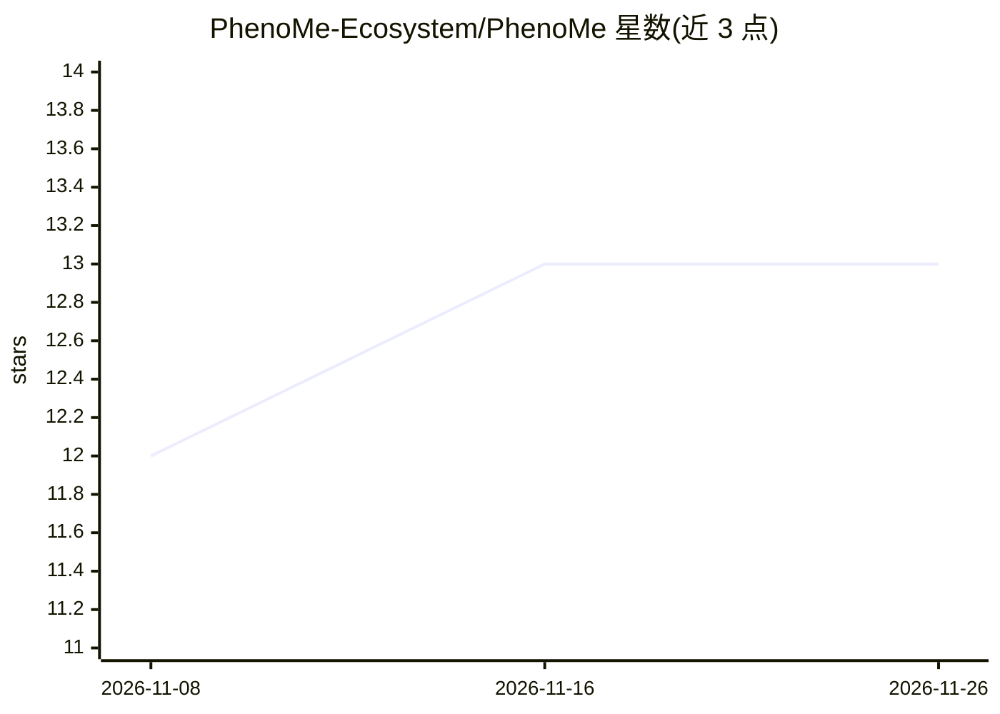

# PhenoMe-Ecosystem/PhenoMe

⭐ 13 · Python · MIT · 推送 2026-11-24 · [GitHub](https://github.com/PhenoMe-Ecosystem/PhenoMe) · [官网](https://phenome-ecosystem.github.io/PhenoMe/) · 组织维护

**面向显微成像表型分析的深度学习嵌入框架**

PhenoMe 是模块化、数据集与模型无关的表型分析框架：用 DINOv2 或自定义视觉模型提取嵌入，结合图像属性做距离量化、异常检测、属性提取与相关性分析，并生成基于 Plotly 的 PCA/t-SNE/UMAP 交互可视化与独立 HTML 报告。提供 pip 包、napari 插件、Colab 笔记本与论文复现指南，CUDA 可用时使用 NVIDIA GPU，同一安装也可在 CPU 上运行。面向显微成像与生物影像研究者。

## 筛选速览

| 维度 | 判定 | 备注 |
|---|---|---|
| AI 角色 | `ai-native` | 本体是模型或模型工具 |
| 许可风险 | `permissive` | MIT |
| 部署形态 | `library` | 以包/库形式分发 |
| 模型依赖 | — | README 未给出锁定关系 |
| 硬件要求 | `cpu-ok` | |
| 安装摩擦 | `medium` | 含编译或系统依赖之一 |
| 成熟度 | — | 结构信号不足 |

## 能力要点

- 模型无关：支持 DINOv2 及 PyTorch/TensorFlow/Keras 自定义模型提取嵌入
- 分析工具包：距离量化、异常检测、属性提取与相关性分析
- Plotly 交互式 PCA/t-SNE/UMAP 可视化与自动 HTML 报告
- 提供 Colab 快速启动与论文复现指南

## 适用场景

- 对显微图像数据集做表型量化与异常检测
- 用嵌入向量做降维可视化与聚类探索
- 复现已发表论文中的表型分析流程

## 场景标签

`科研工具` · 领域:学习与行业

## 证据(README 行号)

> L2:  A modular, dataset-agnostic and model-agnostic framework for phenotyping analysis, combining deep learning embeddin
> L21: - 🛠️ **Analysis Toolkit**: Distance quantification, anomaly detection, property extraction, and correlation analysi

## 星数曲线

2026-11-08 12 → 2026-11-26 13（+1）

---
*卡片 v1 · prompt 1.4 · 生成 2026-11-18 · 置信度 high · 依据 README sha `4740f0aae48a` · [字段定义](../../DATASET.md)*
