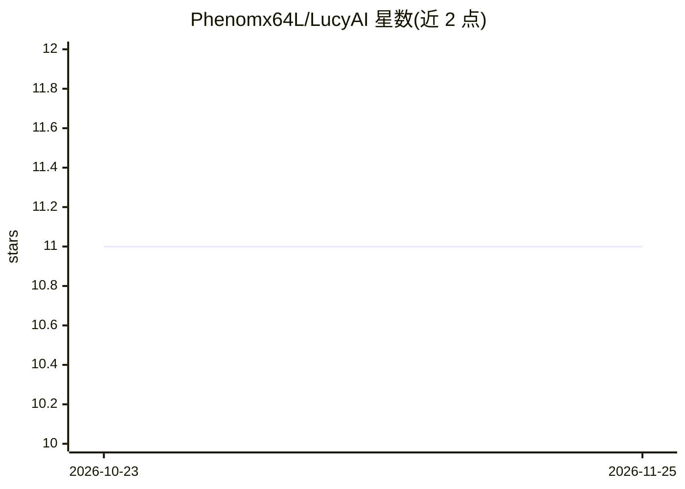

# Phenomx64L/LucyAI

⭐ 11 · Rust · GPL-3.0 · 推送 2026-09-18 · [GitHub](https://github.com/Phenomx64L/LucyAI) · 个人维护

**Windows 系统管理员的本地优先 AI 助手：自然语言执行、合规审计**

面向 Windows 系统管理员的桌面助手，使用 Rust 与 egui 构建原生界面，不依赖嵌入式浏览器。功能包括：自然语言提出命令并在用户批准后执行、CIS 合规审计、读取事件日志、资产清点，以及按机器记忆事实与提炼会话。通过 Ollama 接入本地模型，也可接云端提供商；私有模式下数据不出本机。需 stable Rust 工具链在 Windows 10/11 上从源码构建运行，许可证为 GPLv3。

## 筛选速览

| 维度 | 判定 | 备注 |
|---|---|---|
| AI 角色 | `ai-enhanced` | 去掉 AI 部分产品仍成立 |
| 许可风险 | `viral` | GPL-3.0 |
| 部署形态 | `None` |  |
| 模型依赖 | local-ok | 支持本地模型 |
| 硬件要求 | — | 无带数字的原话,不猜 |
| 安装摩擦 | `low` | 无编译、无系统依赖或容器化 |
| 成熟度 | — | 结构信号不足 |

## 能力要点

- 自然语言命令提案与批准后执行（Terminal IA）
- CIS 合规审计并给出每项判定的证据
- NexShell 提供本地或 WinRM 远程 PowerShell
- 按机器维护记忆：事实、提炼会话、摄取手册

## 适用场景

- 用日常语言在 Windows 机器上执行管理命令
- 对服务器做 CIS 合规检查并留存证据
- 盘点监听端口、服务、已装软件与证书
- 本地模型离线环境下管理不外传数据的机器

## 场景标签

`AI 助手` · 领域:对话与助手

## 证据(README 行号)

> L15: Lucy administers Windows machines. It reports how they're doing, runs what you
> L17: inventory, and remembers what it has learned about each box. It talks to local
> L97: Requires stable Rust and Windows 10/11.

## 星数曲线

2026-10-23 11 → 2026-11-25 11（+0）

---
*卡片 v1 · prompt 1.4 · 生成 2026-11-18 · 置信度 high · 依据 README sha `2f08255c0a03` · [字段定义](../../DATASET.md)*
