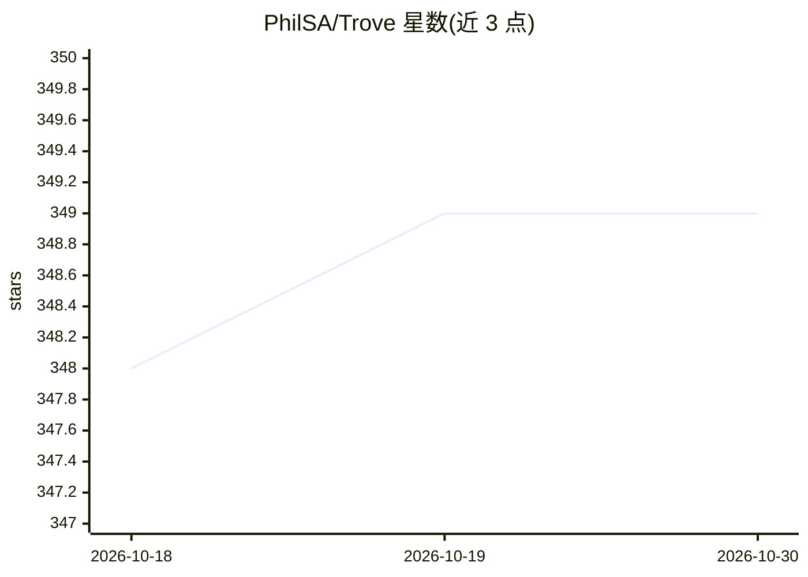

# PhilSA/Trove

⭐ 349 · C# · MIT · 推送 2026-04-14 · [GitHub](https://github.com/PhilSA/Trove) · 个人维护

**Unity DOTS 工具包集合：状态机、属性、Utility AI 等 ECS 开发组件**

面向 Unity DOTS（ECS）开发者的工具包集合，通过 OpenUPM 以 scoped registry 方式安装。包含通用工具、事件系统、多态结构体代码生成、状态机模板、实体属性与修饰规则、空间查询、Utility AI 决策系统、补间动画、FMOD 音频接口与调试绘制等包。设计目标为性能、可定制、Netcode 兼容、低架构侵入。其中 Utility AI 包为 ECS 提供决策系统，AI 仅为集合中的一个组件。

## 筛选速览

| 维度 | 判定 | 备注 |
|---|---|---|
| AI 角色 | `ai-enhanced` | 去掉 AI 部分产品仍成立 |
| 许可风险 | `permissive` | MIT |
| 部署形态 | `None` |  |
| 模型依赖 | — | README 未给出锁定关系 |
| 硬件要求 | — | 无带数字的原话,不猜 |
| 安装摩擦 | `low` | 无编译、无系统依赖或容器化 |
| 成熟度 | — | 结构信号不足 |

## 能力要点

- 10 个独立包覆盖事件系统、状态机、属性、空间查询等 ECS 常用机制
- Utility AI 包提供 ECS 环境下的决策系统
- Polymorphic Structs 代码生成支持 burst 兼容的非托管多态行为
- 通过 OpenUPM scoped registry 安装

## 适用场景

- 在 Unity DOTS 项目中搭建 RPG 属性/增益/堆叠强化等玩法机制
- 为 ECS 实体实现无结构性变更的状态机与事件系统
- 使用 Utility AI 实现实体决策行为

## 场景标签

 · 领域:游戏开发/Unity 组件库

## 证据(README 行号)

> L1: Trove is a collection of packages for Unity DOTS.
> L34: |**Utility AI**|com.trove.utilityai|Trove Utility AI provides a flexible and efficient decision-making system for E

## 星数曲线

2026-10-18 348 → 2026-10-30 349（+1）

---
*卡片 v1 · prompt 1.4 · 生成 2026-10-21 · 置信度 high · 依据 README sha `b33df500a718` · [字段定义](../../DATASET.md)*
