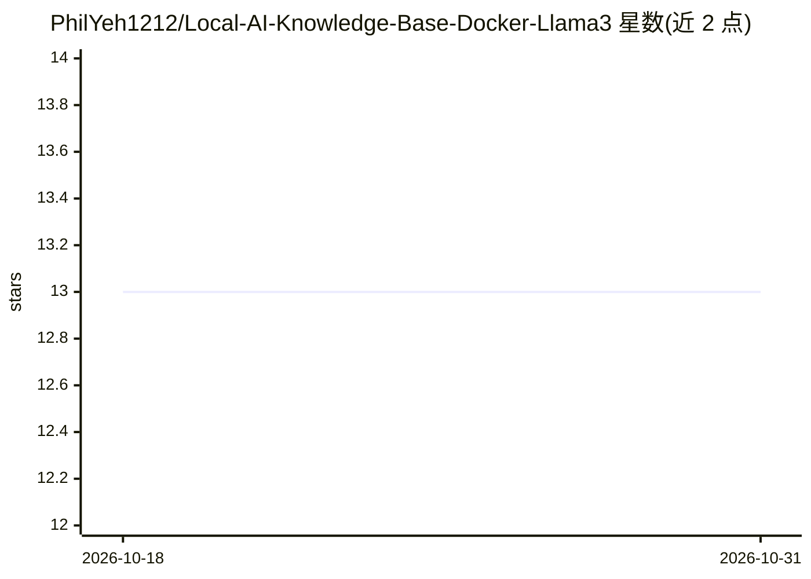

# PhilYeh1212/Local-AI-Knowledge-Base-Docker-Llama3

⭐ 13 · 推送 2026-05-11 · [GitHub](https://github.com/PhilYeh1212/Local-AI-Knowledge-Base-Docker-Llama3) · 个人维护

**自托管的离线 RAG 知识库问答栈（Docker+Llama 3+Ollama）**

面向终端用户与企业的私有文档问答系统：基于 Docker Compose 编排 Ollama（运行 Llama 3 8B/70B）、LangChain 做 RAG 编排、ChromaDB 做向量检索、Streamlit 提供 Web 聊天界面。用户指向文档文件夹（支持 PDF/DOCX/TXT/Markdown/源代码），即可离线对话并带引用回答，无遥测。以商业产品形式在 Gumroad 出售（$59），购买含源码，许可禁止再分发与开源；一键脚本 start.sh/start.bat 启动。硬件最低 16GB 内存 CPU 运行 8B Q4 模型。

## 筛选速览

| 维度 | 判定 | 备注 |
|---|---|---|
| AI 角色 | `ai-native` | 本体是模型或模型工具 |
| 许可风险 | `none` | — |
| 部署形态 | `self-host` | docker 或自建部署 |
| 模型依赖 | local-ok | 支持本地模型 |
| 硬件要求 | `cpu-ok` | |
| 安装摩擦 | `low` | 无编译、无系统依赖或容器化 |
| 成熟度 | — | 结构信号不足 |

## 能力要点

- 100% 离线运行，模型下载后无需 API key
- Ollama 运行 Llama 3（8B 笔记本 / 70B 需 48GB+ VRAM 工作站）
- PDF/DOCX/TXT/Markdown/源代码文档的 RAG 检索与带引用回答
- Docker Compose 单文件编排全部组件，一键脚本启动

## 适用场景

- 涉密工程手册在本地问答而不外发云端
- 受数据驻留政策约束的公司在本地保留全部查询
- 研究人员离线与论文 PDF 对话

## 场景标签

`文档问答` `知识库管理` · 领域:知识与检索

## 证据(README 行号)

> L18: > A self-hosted RAG (Retrieval-Augmented Generation) stack with Llama 3, Docker, and one-click start scripts. Chat 
> L26: - **RAG over your documents** — point it at a folder, get a chatbot trained on your files

## 星数曲线

2026-10-18 13 → 2026-10-31 13（+0）

---
*卡片 v1 · prompt 1.4 · 生成 2026-10-31 · 置信度 high · 依据 README sha `0afffdf55e92` · [字段定义](../../DATASET.md)*
