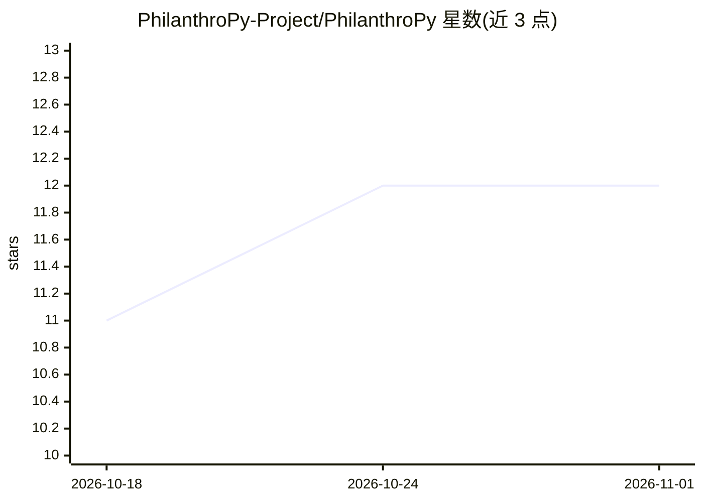

# PhilanthroPy-Project/PhilanthroPy

⭐ 12 · Python · MIT · 推送 2026-10-25 · [GitHub](https://github.com/PhilanthroPy-Project/PhilanthroPy) · [官网](https://PhilanthroPy-Project.github.io/PhilanthroPy/) · 个人维护

**面向非营利筹款的 sklearn 兼容捐赠者预测分析库**

Python 库，直接嵌入 sklearn.pipeline.Pipeline，覆盖非营利与学术医学中心筹款的完整预测流程：CRM 数据清洗、财富筛选插补、RFM 分段、大额捐赠倾向评分、流失预测、计划捐赠意向与收入预测。提供 CLI（礼品导出转评分 CSV）、R 语言 reticulate 调用路径，以及 Raiser's Edge、Salesforce NPSP、CiviCRM 三种 CRM 的导入桥接。设计上防时间泄漏，数据不离开本机、无遥测。单人维护，MIT 许可，声明 bus factor 为 1；分级成熟度：预处理与核心分类器为 Tier 1，grateful-patient 特征化为 Tier 2 Beta，财务预测与 experimental 为 Tier 3。

## 筛选速览

| 维度 | 判定 | 备注 |
|---|---|---|
| AI 角色 | `ai-native` | 本体是模型或模型工具 |
| 许可风险 | `permissive` | MIT |
| 部署形态 | `library` | 以包/库形式分发 |
| 模型依赖 | — | README 未给出锁定关系 |
| 硬件要求 | — | 无带数字的原话,不猜 |
| 安装摩擦 | `low` | 无编译、无系统依赖或容器化 |
| 成熟度 | — | 结构信号不足 |

## 能力要点

- sklearn Pipeline 兼容的捐赠倾向/流失/计划捐赠评分模型
- Raiser's Edge、Salesforce NPSP、CiviCRM 三种 CRM 的导入桥接与统一 read_gifts 入口
- CLI 无 Python 代码即可完成特征生成、训练与评分（含 leadership 升级模型）
- 无遥测、无网络调用的本地数据处理（CI 强制网络白名单测试）

## 适用场景

- 按大额捐赠可能性对捐赠者排序，生成募捐通话名单
- 从 CRM 礼品导出直接生成捐赠者特征并评分
- 预测 100-999 美元档捐赠者下财年升级到 1000 美元的可能性

## 场景标签

`数据分析` · 领域:效率与自动化

## 证据(README 行号)

> L21: PhilanthroPy is a Python library that slots directly into `sklearn.pipeline.Pipeline`. It covers the full predictiv
> L3:  Rank your donors by who is most likely to make a major gift: leakage-safe scikit-learn models for nonprofit and hos

## 星数曲线

2026-10-18 11 → 2026-11-01 12（+1）

---
*卡片 v1 · prompt 1.4 · 生成 2026-11-01 · 置信度 high · 依据 README sha `f0cb8d1b56d0` · [字段定义](../../DATASET.md)*
