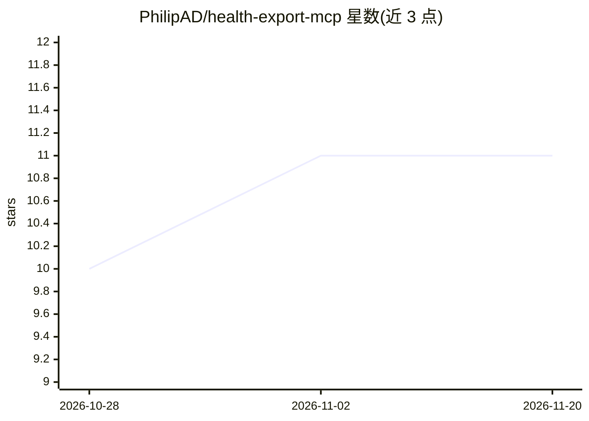

# PhilipAD/health-export-mcp

⭐ 11 · JavaScript · MIT · 推送 2026-11-13 · [GitHub](https://github.com/PhilipAD/health-export-mcp) · [官网](https://www.healthexport.dev) · 个人维护

**把 Apple Health 数据暴露给 AI agent 查询的本地 MCP 服务器**

一个读取 Apple Health 导出文件的 MCP 服务器，通过本地 stdio 向 agent 提供 194 项指标、21 个工具（19 个只读）与 23 个 prompts，返回带单位、日期范围与覆盖率信息的 JSON。零依赖、无需账号、不做网络请求。数据来源为 iOS 应用 MetricBridge 写出的导出文件（iCloud/文件夹/LAN），该应用免费试用 7 天后需一次性购买 $24.99；本服务器为 MIT 许可。需 Node.js 18+，并给出 --demo 合成数据集供无 iPhone 用户试用。

## 筛选速览

| 维度 | 判定 | 备注 |
|---|---|---|
| AI 角色 | `ai-ecosystem` | LLM/agent 周边工具 |
| 许可风险 | `permissive` | MIT |
| 部署形态 | `library` | 以包/库形式分发 |
| 模型依赖 | — | README 未给出锁定关系 |
| 硬件要求 | — | 无带数字的原话,不猜 |
| 安装摩擦 | `low` | 无编译、无系统依赖或容器化 |
| 成熟度 | — | 结构信号不足 |

## 能力要点

- 21 个 MCP 工具覆盖指标、趋势对比、睡眠、锻炼、事件记录等查询
- 本地 stdio 运行，零依赖，读取本地文件且不发网络请求
- 支持 --demo 合成数据集，无需 iPhone 即可试用全部工具
- 兼容 Claude Desktop 的 .mcpb 安装包与多种客户端配置

## 适用场景

- 让 Claude/Cursor 等 agent 用自然语言查询自己的健康数据
- 对比不同时间段的 HRV、睡眠等指标趋势
- 通过 webhook 把健康导出数据接入 ChatGPT、n8n、Home Assistant

## 场景标签

 · 领域:个人健康数据/AI 工具接入

## 证据(README 行号)

> L3: **An MCP server for your own Apple Health data.** 194 metrics, 21 tools (19 read-only, plus two that log events to t
> L42: It's an MCP server that turns your Apple Health export into tools your AI agent can query in natural language: HRV,
> L113: ## Works with Claude, Cursor, ChatGPT, OpenClaw, Hermes

## 星数曲线

2026-10-28 10 → 2026-11-20 11（+1）

---
*卡片 v1 · prompt 1.4 · 生成 2026-11-18 · 置信度 high · 依据 README sha `c7d038e79cfc` · [字段定义](../../DATASET.md)*
