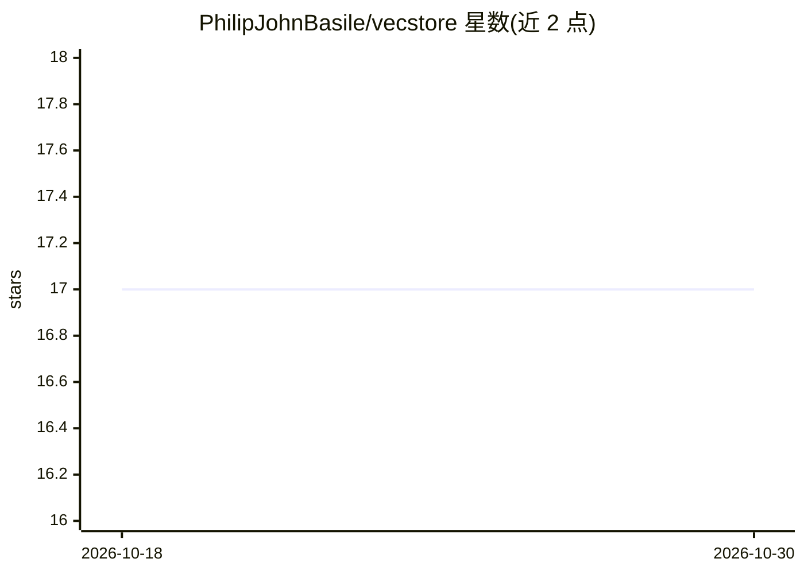

# PhilipJohnBasile/vecstore

⭐ 17 · Rust · MIT · 推送 2026-09-10 · [GitHub](https://github.com/PhilipJohnBasile/vecstore) · 个人维护

**可嵌入 Rust 应用的向量数据库，支持元数据过滤与持久化**

以 Rust 库形式提供的嵌入型向量数据库：在应用内直接存储向量与元数据、执行相似度检索、持久化保存与重载。支持元数据过滤与混合检索示例，提供可选的 Python 与 WebAssembly 接口（Cargo feature）。默认快速入门使用固定向量，无需模型、服务或 API key。项目自述为 alpha（0.1.x），API 与文件格式可能变化；GPU、服务端、嵌入与分布式组件为可选配置，默认快速入门不验证其就绪状态。

## 筛选速览

| 维度 | 判定 | 备注 |
|---|---|---|
| AI 角色 | `ai-ecosystem` | LLM/agent 周边工具 |
| 许可风险 | `permissive` | MIT |
| 部署形态 | `None` |  |
| 模型依赖 | — | README 未给出锁定关系 |
| 硬件要求 | — | 无带数字的原话,不猜 |
| 安装摩擦 | `low` | 无编译、无系统依赖或容器化 |
| 成熟度 | `idea` | |

## 能力要点

- Rust 库形式嵌入应用内，向量与元数据同存
- 元数据过滤与混合检索（hybrid search）示例
- 可选 Python 与 WASM 接口（Cargo feature）
- 快速入门无需模型、服务或 API key

## 适用场景

- 在 Rust 应用内嵌入向量存储与相似度检索
- 带元数据过滤的记录检索
- 评估向量数据库时用固定向量快速上手

## 场景标签

`向量数据库` · 领域:知识与检索

## 证据(README 行号)

> L3: An embeddable vector database for Rust, with optional Python and WebAssembly interfaces. Store vectors alongside met
> L7: **Status: alpha, version 0.1.x.** APIs and file formats can change. Use regenerable data while evaluating the projec

## 星数曲线

2026-10-18 17 → 2026-10-30 17（+0）

---
*卡片 v1 · prompt 1.4 · 生成 2026-10-30 · 置信度 high · 依据 README sha `1a193992415f` · [字段定义](../../DATASET.md)*
