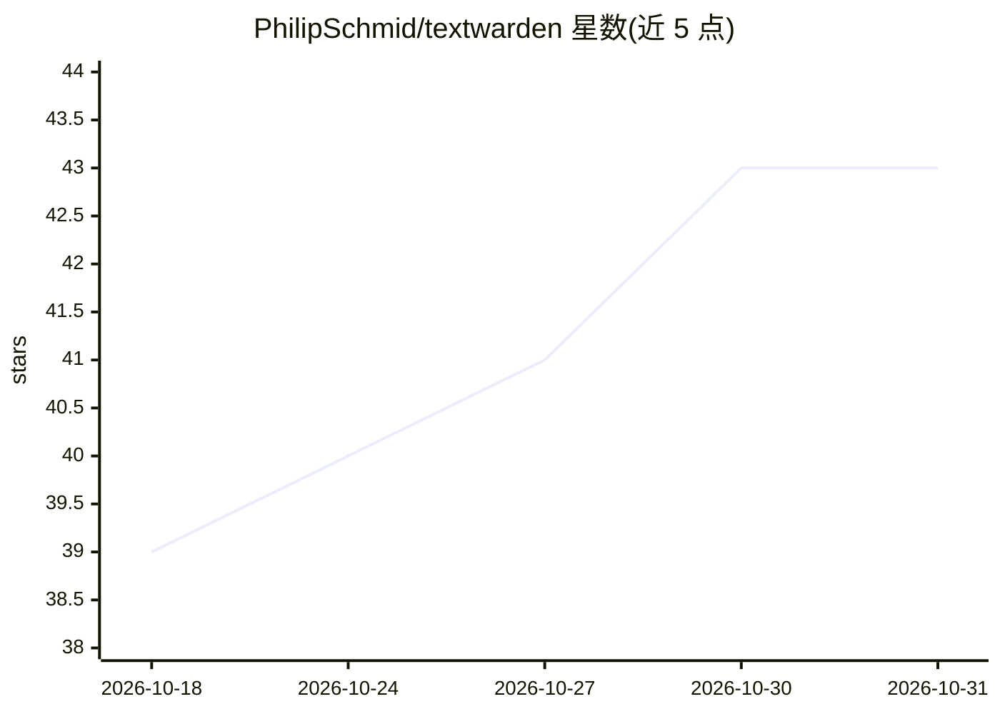

# PhilipSchmid/textwarden

⭐ 43 · Swift · Apache-2.0 · 推送 2026-10-27 · [GitHub](https://github.com/PhilipSchmid/textwarden) · 个人维护

**macOS 端上隐私语法检查器，全程本地运行**

面向 macOS 用户的免费开源英文语法、拼写、标点与文风检查工具：读取文本框内容后用内置的 Harper 本地检查并以下划线或悬浮指示器给出建议，支持多种英语方言、自定义词汇与可读性评分。可选 AI 功能（风格建议、Quick Rewrite、AI Compose）通过 Apple Intelligence 在设备端运行，默认关闭。仅支持 macOS 14+，Apple Intelligence 功能需 macOS 26 与 M 系列芯片，无 Windows/Linux/iOS/Android 版本。从 GitHub Releases 下载 .dmg 安装，授予辅助功能权限后使用。

## 筛选速览

| 维度 | 判定 | 备注 |
|---|---|---|
| AI 角色 | `ai-enhanced` | 去掉 AI 部分产品仍成立 |
| 许可风险 | `permissive` | Apache-2.0 |
| 部署形态 | `desktop` | 安装包/桌面程序 |
| 模型依赖 | — | README 未给出锁定关系 |
| 硬件要求 | — | 无带数字的原话,不猜 |
| 安装摩擦 | `low` | 无编译、无系统依赖或容器化 |
| 成熟度 | `idea` | |

## 能力要点

- 内置 Harper 本地语法检查，文本不上传
- 可选 Apple Intelligence 设备端 AI 写作工具（默认关闭）
- 支持 5 种英语方言、自定义词汇与 69 种非英语语言检测抑制
- 覆盖 Slack、Office、浏览器等大量 Mac 应用的实时检查

## 适用场景

- 在聊天、邮件、笔记等 Mac 应用中边写边查英文语法
- 隐私敏感场景下不联网使用语法与拼写检查
- 用 Apple Intelligence 对选中文本按写作风格改写

## 场景标签

`AI 写作` · 领域:内容生成

## 证据(README 行号)

> L23: - **Your writing stays on your Mac:** Grammar checks run locally with Harper, and optional AI features use Apple In
> L52: These features are off by default. Grammar checking, spell checking, custom dictionaries, language detection, and r

## 星数曲线

2026-10-18 39 → 2026-10-31 43（+4）

---
*卡片 v1 · prompt 1.4 · 生成 2026-10-25 · 置信度 high · 依据 README sha `a14c52e200ea` · [字段定义](../../DATASET.md)*
