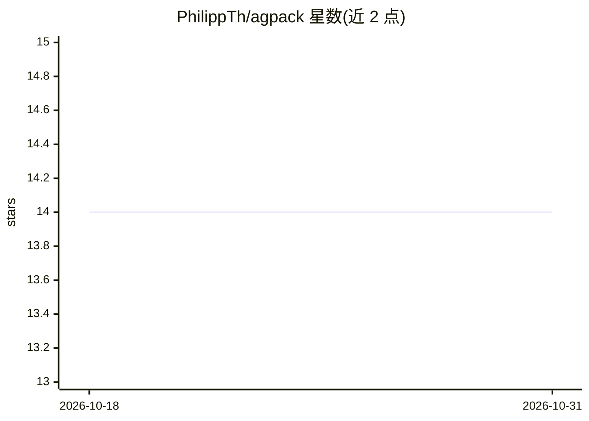

# PhilippTh/agpack

⭐ 14 · Python · GPL-3.0 · 推送 2026-07-16 · [GitHub](https://github.com/PhilippTh/agpack) · 个人维护

**跨 AI 编码工具的资产包管理器：一份 YAML 同步技能/MCP/命令**

面向开发者的 AI 编码工具资产管理工具：在单个 agpack.yml 中声明 skills、commands、agents、MCP servers、hooks 等资源，运行 agpack sync 后从 git 仓库拉取并部署到各工具期望的目录与配置文件。内置 Claude Code、Codex、Cursor、GitHub Copilot、Gemini CLI、OpenCode、Windsurf 等九个目标清单，支持自定义目标与全局配置。资源分 copy-directory/copy-file/edit-file 三类；edit-file 仅改写自己拥有的键，清理时精确回滚，TOML 往返保留注释与顺序。限制：需要 Python 3.11+ 与 PATH 上的 git；Windsurf/Antigravity 的 MCP 配置为用户全局位置，不在管理范围。

## 筛选速览

| 维度 | 判定 | 备注 |
|---|---|---|
| AI 角色 | `ai-ecosystem` | LLM/agent 周边工具 |
| 许可风险 | `viral` | GPL-3.0 |
| 部署形态 | `library` | 以包/库形式分发 |
| 模型依赖 | — | README 未给出锁定关系 |
| 硬件要求 | — | 无带数字的原话,不猜 |
| 安装摩擦 | `low` | 无编译、无系统依赖或容器化 |
| 成熟度 | — | 结构信号不足 |

## 能力要点

- 单一声明文件同步 skills/MCP/commands/agents/hooks 到多个 AI 编码工具
- 三种资源模型：copy-directory / copy-file / edit-file（按键补丁）
- 内置 9 个工具目标清单，可用 YAML 覆盖或自定义新目标
- 清理精确回滚、TOML 格式保留、幂等写入

## 适用场景

- 在多个 AI 编码工具间共享同一套 skills 与 MCP 配置
- 团队统一管理项目内 AI 工具资源的版本与更新
- 全局分发希望所有项目都有的 agent 技能

## 场景标签

 · 领域:开发工具/AI 资产管理

## 证据(README 行号)

> L12: A package manager for AI coding tools. Declare skills, commands, agents, MCP servers, hooks, and any other resource
> L59: A **target** is a YAML manifest that maps resource type names (`skills`, `commands`, `mcp`, anything you like) to a
> L180: agpack ships manifests for nine tools: `claude`, `codex`, `copilot`, `cursor`, `gemini`, `opencode`, `pi`, `windsu

## 星数曲线

2026-10-18 14 → 2026-10-31 14（+0）

---
*卡片 v1 · prompt 1.4 · 生成 2026-10-31 · 置信度 high · 依据 README sha `169115981754` · [字段定义](../../DATASET.md)*
