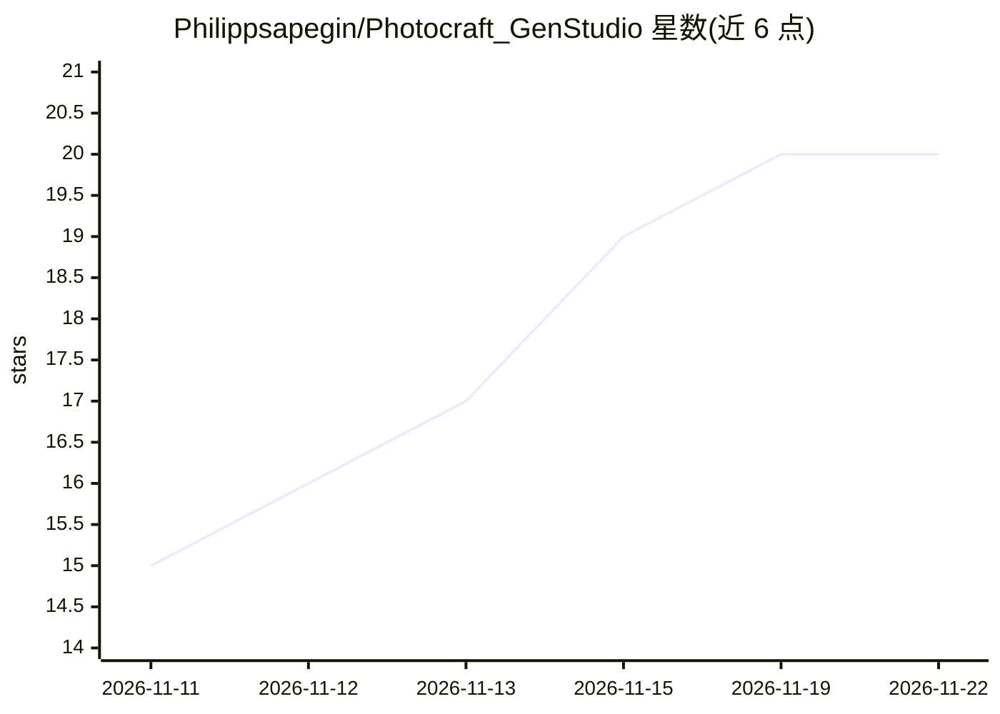

# Philippsapegin/Photocraft_GenStudio

⭐ 20 · Python · GPL-3.0 · 推送 2026-11-12 · [GitHub](https://github.com/Philippsapegin/Photocraft_GenStudio) · 个人维护

**为 PhotoCraft 增加 AI 生成/填充/抠图等工具的插件套件**

面向 PhotoCraft（Windows x64）的 AI 图像生成插件套件（GenGate），提供文生图与参考图生成的 Studio、选区内生成的 Ai Fill、Remove Brush 对象移除、Select Subject/Sky/Remove Background 等 AI 选取工具。双引擎：Direct（无需 ComfyUI，自带 CUDA 运行时）与 ComfyUI（可运行浏览器中打开的活动工作流）。支持 Qwen Image 2.1、FLUX 3、FIBO 2.0 Edit Turbo 预设及 YOLO-World/SAM3 选取引擎，模型可复用 ComfyUI/models 目录。以 Windows 附加包 ZIP + Setup.cmd 安装，标注为进行中（WIP）。

## 筛选速览

| 维度 | 判定 | 备注 |
|---|---|---|
| AI 角色 | `ai-native` | 本体是模型或模型工具 |
| 许可风险 | `viral` | GPL-3.0 |
| 部署形态 | `desktop` | 安装包/桌面程序 |
| 模型依赖 | — | README 未给出锁定关系 |
| 硬件要求 | — | 无带数字的原话,不猜 |
| 安装摩擦 | `medium` | 含编译或系统依赖之一 |
| 成熟度 | `idea` | |

## 能力要点

- Direct 与 ComfyUI 双引擎，Direct 自带独立 CUDA 运行时
- Ai Fill、Remove Brush、AI 选取（YOLO-World/SAM3）等原生编辑工具
- Qwen Image 2.1 / FLUX 3 / FIBO 2.0 Edit Turbo 三套预设，模型文件就地复用
- LoRA Explorer 支持强度、别名、触发词管理与拖拽引用

## 适用场景

- 在照片编辑器内直接做文生图与参考图生成
- 对选区做 AI 填充或移除画面中的物体
- 一键选取主体/天空/移除背景
- 在 ComfyUI 工作流基础上通过 Studio 编辑生成

## 场景标签

`图像生成` `图像视频处理` · 领域:内容生成

## 证据(README 行号)

> L6: A work-in-progress suite for PhotoCraft, adding AI fill, selection and object removal, alongside a straightforward i
> L30: |**GenGate**|**Filter → Plugins → GenGate**. Text-to-image and reference-based generation, drag-and-drop references

## 星数曲线

2026-11-11 15 → 2026-11-22 20（+5）

---
*卡片 v1 · prompt 1.4 · 生成 2026-11-18 · 置信度 high · 依据 README sha `b2e7253b049a` · [字段定义](../../DATASET.md)*
