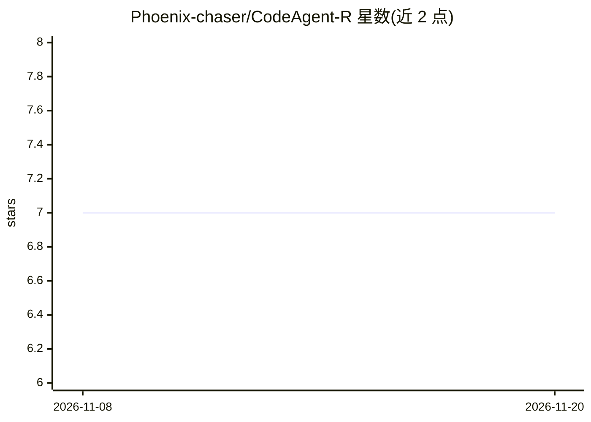

# Phoenix-chaser/CodeAgent-R

⭐ 7 · Python · MIT · 推送 2026-11-14 · [GitHub](https://github.com/Phoenix-chaser/CodeAgent-R) · 个人维护 · 中文 README

**面向代码修复的后训练实验平台：可审计地微调与评测模型**

对 Qwen2.5-Coder-7B 系统尝试 6 种后训练方法（教师蒸馏 SFT、DPO×3、RFT×2、混合训练、Best-of-N 推理），并给出每种方法的根因分析。核心机制包括：来源组隔离的冻结数据划分、变异测试审计的任务池、以 dev 执行通过率做模型选型、Base 对照参与与 3-seed 复现协议。README 披露边界：评分会执行模型代码，生产使用需自行补容器与资源隔离。

## 筛选速览

| 维度 | 判定 | 备注 |
|---|---|---|
| AI 角色 | `ai-ecosystem` | LLM/agent 周边工具 |
| 许可风险 | `permissive` | MIT |
| 部署形态 | `library` | 以包/库形式分发 |
| 模型依赖 | — | README 未给出锁定关系 |
| 硬件要求 | — | 无带数字的原话,不猜 |
| 安装摩擦 | `low` | 无编译、无系统依赖或容器化 |
| 成熟度 | — | 结构信号不足 |

## 能力要点

- 104 题/52 来源组任务池，变异测试审计检测假标签
- 来源组冻结 64/20/20 划分，防止 dev/test 泄漏
- 基于 dev 执行通过率的模型选型，平局保留 Base
- 3-seed 复现协议：均值 +1.7pp，零退化

## 适用场景

- 复现代码修复模型的 SFT/DPO/RFT 后训练实验
- 构建带执行选型与数据隔离的评测管线
- 研究后训练方法的失败模式与根因

## 场景标签

`微调` `模型评测` `强化学习` · 领域:评测与运维

## 证据(README 行号)

> L12: 面向代码修复的后训练实验平台。对 Qwen2.5-Coder-7B 系统性尝试了 6 种后训练方法（教师蒸馏 SFT / DPO×3 / RFT×2 / 混合训练 / Best-of-N 推理），每种方法都有根因分析。
> L71: |任务基准|104 题 / 52 来源组，变异测试审计（幸存变异体 = 假标签检测）|
> L74: |模型选择|dev **执行通过率**选型，Base 参与对照，平局保留 Base|

## 星数曲线

2026-11-08 7 → 2026-11-20 7（+0）

---
*卡片 v1 · prompt 1.4 · 生成 2026-11-20 · 置信度 high · 依据 README sha `1ed32b1bef5c` · [字段定义](../../DATASET.md)*
