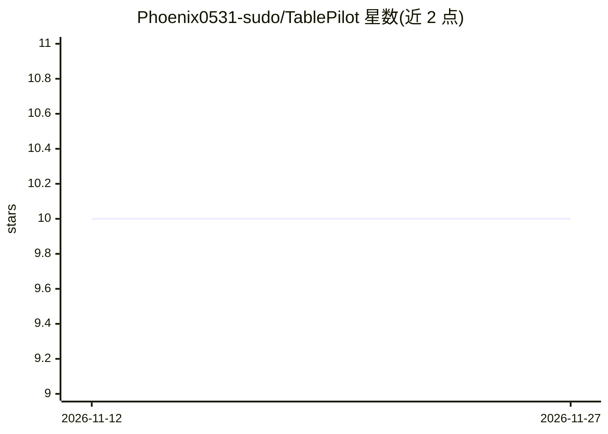

# Phoenix0531-sudo/TablePilot

⭐ 10 · C++ · MIT · 推送 2026-11-08 · [GitHub](https://github.com/Phoenix0531-sudo/TablePilot) · [官网](https://phoenix0531-sudo.github.io/TablePilot/) · 个人维护 · 中文 README

**本地优先的脏表格分析工作台：画像、清洗、报告不出本地**

混合架构的本地表格分析工具：FastAPI 分析服务负责表格画像、清洗预览、分析计划与可解释报告生成，Qt/C++ 桌面外壳提供键表交互界面，两者通过同一套 HTTP 端点驱动。支持 Excel/CSV/TXT 本地文件，默认不向云端上传数据；另含可选的本地模型叙述路径（ollama 式）与通过 Exa API 的网页检索侧栏。桌面二进制发布于 Releases，服务可源码或 Docker 运行。

## 筛选速览

| 维度 | 判定 | 备注 |
|---|---|---|
| AI 角色 | `ai-enhanced` | 去掉 AI 部分产品仍成立 |
| 许可风险 | `permissive` | MIT |
| 部署形态 | `desktop` | 安装包/桌面程序 |
| 模型依赖 | local-ok | 支持本地模型 |
| 硬件要求 | — | 无带数字的原话,不猜 |
| 安装摩擦 | `low` | 无编译、无系统依赖或容器化 |
| 成熟度 | — | 结构信号不足 |

## 能力要点

- 表格画像、清洗预览、清洗输出与 Markdown/HTML 可解释报告的完整端点族
- 本地优先：默认仅读取本地文件，服务运行于 127.0.0.1
- Qt/C++ 桌面外壳 + FastAPI 服务的混合架构，服务可独立使用
- 可选 local_ai 路径指向本地模型（ollama 式）

## 适用场景

- 对杂乱的 Excel/CSV 文件做数据质量画像与异常检测
- 预览清洗效果后再决定是否落地清洗结果
- 在不上传数据的前提下生成可解释分析报告
- 通过 API 将表格分析能力嵌入自己的流程

## 场景标签

`数据分析` · 领域:效率与自动化

## 证据(README 行号)

> L32: TablePilot is a **local-first workbench for messy tables**: it takes chaotic Excel / CSV / TXT files off your disk 
> L34: It is a hybrid stack. A **Python FastAPI analysis service** (`analysis_service/`) does the profiling, cleaning, rep
> L46: - **Agent narrative** — `POST /api/agent/query` answers a free-text question over a table; pass `local_ai: true` to

## 星数曲线

2026-11-12 10 → 2026-11-27 10（+0）

---
*卡片 v1 · prompt 1.4 · 生成 2026-11-20 · 置信度 high · 依据 README sha `3608b0544054` · [字段定义](../../DATASET.md)*
