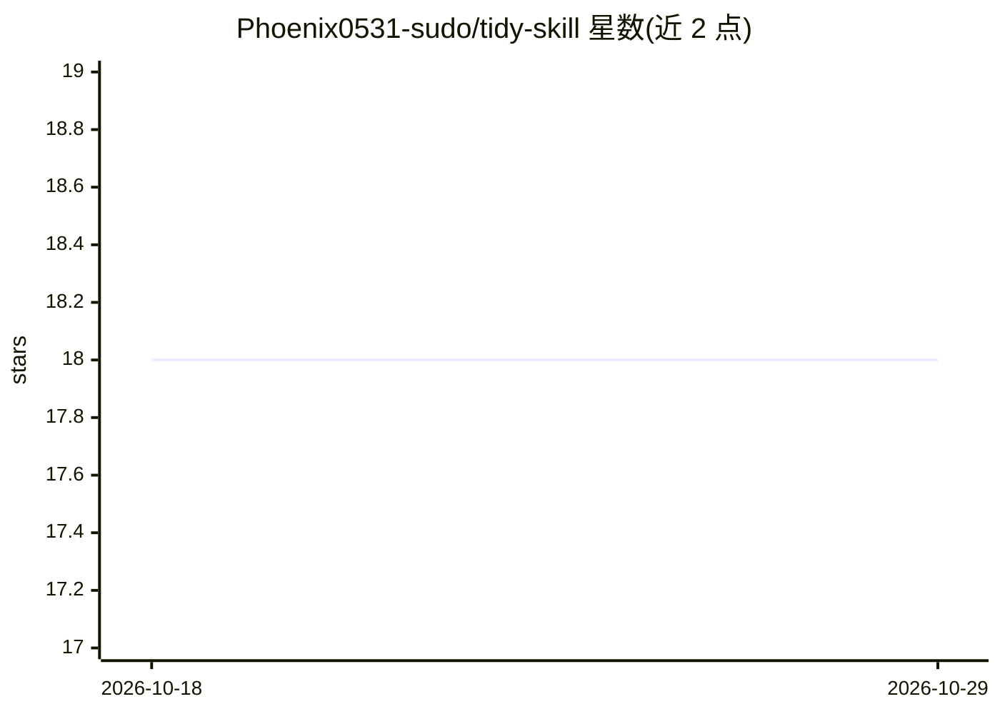

# Phoenix0531-sudo/tidy-skill

⭐ 18 · Python · MIT · 推送 2026-08-09 · [GitHub](https://github.com/Phoenix0531-sudo/tidy-skill) · [官网](https://phoenix0531-sudo.github.io/tidy-skill/) · 个人维护 · 中文 README

**给 AI Agent 的工作区卫生治理技能：审计、分类、安全清理留痕文件**

面向 Claude/Codex/Cursor 等 agent 框架的技能包，治理 agent 在仓库根目录、工作区缓存与本机环境中留下的三类痕迹：提供只读审计（仓库卫生评分 0-100、可疑根文件清单、开发环境审计）、五级产物分类器（写入前判定 A-E 类放置路径）与 DryRun 默认的清理修复脚本，含 CI gate（tidy_doctor 失败退出码 2）。安全动词 dryrun/careful/guard 拒绝自动触碰宿主配置、VHDX、git-tracked 文件。Python 脚本为纯标准库，离线本地运行；声明不支持自动删除正式文档、网络调用与全盘扫描。

## 筛选速览

| 维度 | 判定 | 备注 |
|---|---|---|
| AI 角色 | `ai-ecosystem` | LLM/agent 周边工具 |
| 许可风险 | `permissive` | MIT |
| 部署形态 | `library` | 以包/库形式分发 |
| 模型依赖 | locked-api |  |
| 硬件要求 | — | 无带数字的原话,不猜 |
| 安装摩擦 | `low` | 无编译、无系统依赖或容器化 |
| 成熟度 | — | 结构信号不足 |

## 能力要点

- 三层模型：仓库产物 / 工作区缓存 / 本机环境（含 WSL2、Docker VHDX）
- 五级分类（A-E）与写入前 classify_artifact 路径分类器
- 清理与安装脚本默认 DryRun；guard 拒绝宿主/VHDX/git-tracked 文件
- 仓库卫生评分与 hygiene_snapshot gate 提供 CI 集成

## 适用场景

- 治理 agent 在仓库根目录堆积 plan.md/todo.md 等过程文件
- 在 CI 中用卫生评分与 doctor 退出码拦截卫生漂移
- 审计本机 node_modules/.venv/WSL VHDX 等开发缓存占用

## 场景标签

 · 领域:AI Agent 工具链/开发治理

## 证据(README 行号)

> L58: |**Repository**|Agent artifacts|`plan.md`, `todo.md` pile up in repo root|`audit_agent_artifacts.py`, `score_repo_h
> L97: |**Subscribe (skills CLI)**|Managed copy into agent skill dirs; re-run to update|`npx skills add Phoenix0531-sudo/t
> L106: **Skills CLI (verified discoverable):** standard `skills/tidy-skill/SKILL.md` package. Author-verified for codex /

## 星数曲线

2026-10-18 18 → 2026-10-29 18（+0）

---
*卡片 v1 · prompt 1.4 · 生成 2026-10-29 · 置信度 high · 依据 README sha `47f3775edbdf` · [字段定义](../../DATASET.md)*
