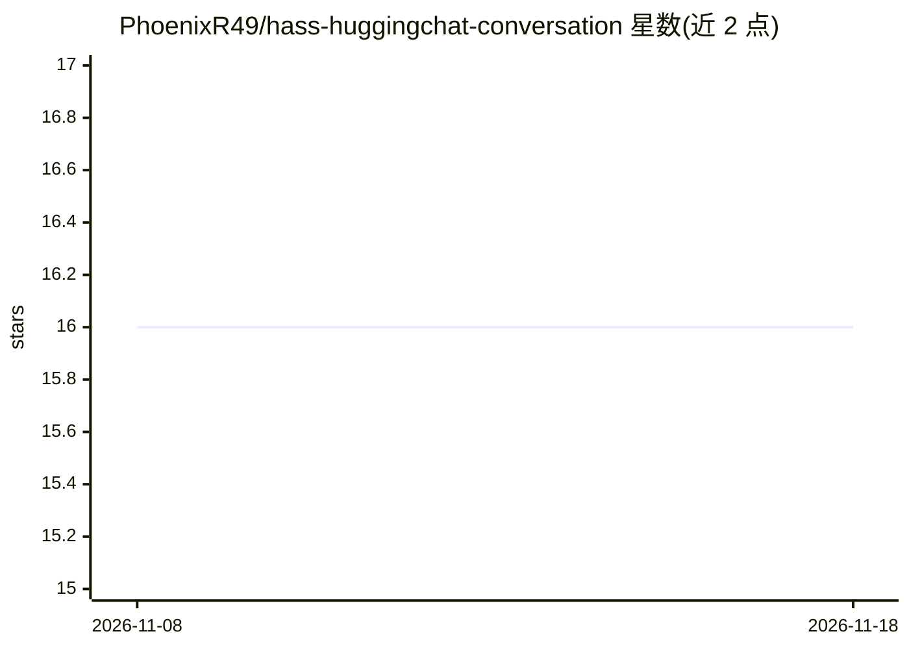

# PhoenixR49/hass-huggingchat-conversation

⭐ 16 · Python · GPL-3.0 · 推送 2026-11-06 · [GitHub](https://github.com/PhoenixR49/hass-huggingchat-conversation) · 个人维护

**让 Home Assistant 通过 HuggingChat 进行对话的集成组件**

Home Assistant 自定义组件（custom component），将 HuggingChat 接入 Home Assistant 的对话（Conversation）与语音助手流程，使助手对话由 HuggingChat 模型生成回答。面向 Home Assistant 用户，提供 HACS 一键安装与手动 git clone 两种方式，手动方式需将 custom_component 文件夹内容放入 /config/custom_components 并重启 Home Assistant。README 含 CI 校验（hassfest/Pylint）与社区论坛链接。

## 筛选速览

| 维度 | 判定 | 备注 |
|---|---|---|
| AI 角色 | `ai-ecosystem` | LLM/agent 周边工具 |
| 许可风险 | `viral` | GPL-3.0 |
| 部署形态 | `None` |  |
| 模型依赖 | — | README 未给出锁定关系 |
| 硬件要求 | — | 无带数字的原话,不猜 |
| 安装摩擦 | `low` | 无编译、无系统依赖或容器化 |
| 成熟度 | — | 结构信号不足 |

## 能力要点

- 为 Home Assistant 提供 HuggingChat 对话代理集成
- 支持 HACS 安装与手动安装两种方式
- 配置后接入 Home Assistant Assist 语音助手流程

## 适用场景

- Home Assistant 用户让语音助手用 HuggingChat 模型回答
- 在 Home Assistant 中使用自定义对话代理
- 通过 HACS 社区商店安装并管理该组件

## 场景标签

`聊天机器人` `语音 Agent` · 领域:对话与助手

## 证据(README 行号)

> L3: Conversation support for Home Assistant using HuggingChat.
> L18: Open your Home Assistant instance and open a repository inside the Home Assistant Community Store.

## 星数曲线

2026-11-08 16 → 2026-11-18 16（+0）

---
*卡片 v1 · prompt 1.4 · 生成 2026-11-18 · 置信度 mid · 依据 README sha `f447dc796ff3` · [字段定义](../../DATASET.md)*
