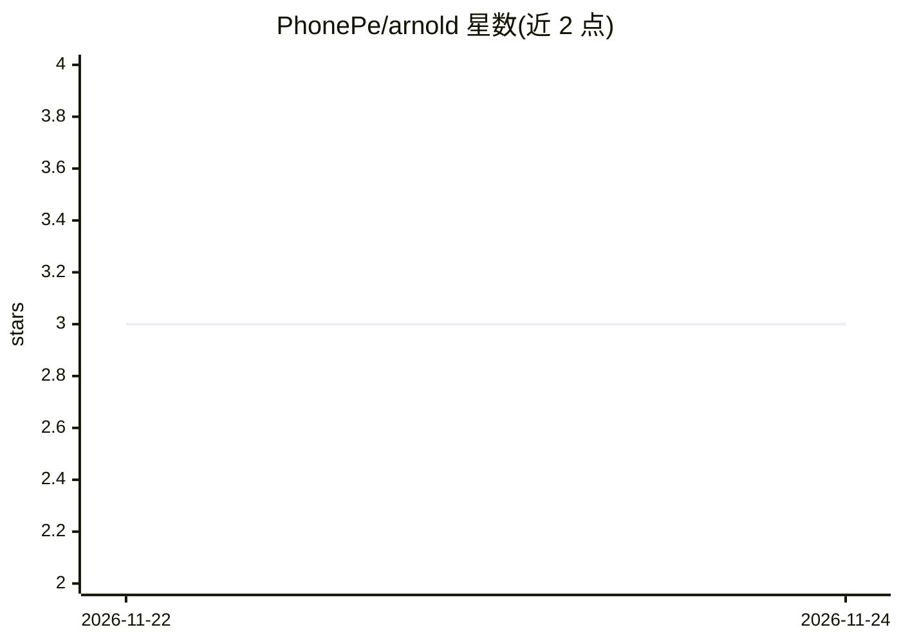

# PhonePe/arnold

⭐ 3 · Java · Apache-2.0 · 推送 2026-11-20 · [GitHub](https://github.com/PhonePe/arnold) · [官网](https://phonepe.github.io/arnold/) · 组织维护

**自托管代码评审平台，为 GitLab/GitHub 提供 AI 评审工作流**

面向 GitLab 与 GitHub 的自托管代码评审平台：提供包含 diff、讨论、草稿评审、个人合并队列与评审统计的评审工作区，并运行 AI 评审工作流，将行内发现回帖到对应的 MR/PR。使用 JDK 17 + Maven 构建，通过 Docker Compose 启动；正式部署使用 GitHub Container Registry 发布的签名镜像，配置项覆盖认证、GitLab OAuth、GitHub App、runner 模式与存储（Aerospike，Elasticsearch 可选）。

## 筛选速览

| 维度 | 判定 | 备注 |
|---|---|---|
| AI 角色 | `ai-enhanced` | 去掉 AI 部分产品仍成立 |
| 许可风险 | `permissive` | Apache-2.0 |
| 部署形态 | `self-host` | docker 或自建部署 |
| 模型依赖 | — | README 未给出锁定关系 |
| 硬件要求 | — | 无带数字的原话,不猜 |
| 安装摩擦 | `low` | 无编译、无系统依赖或容器化 |
| 成熟度 | — | 结构信号不足 |

## 能力要点

- 覆盖 diff、讨论、草稿评审、合并队列与评审统计的完整评审工作区
- AI 评审工作流将行内建议回帖到 MR/PR
- 支持 LOCAL/GITLAB/GITHUB 三种 runner 模式
- 发布签名镜像到 GitHub Container Registry

## 适用场景

- 团队自托管统一管理 GitLab MR 与 GitHub PR 的评审流程
- 用 AI 工作流在合并请求中生成行内评审建议
- 为评审者维护个人优先级合并队列与评审统计

## 场景标签

`代码审查` · 领域:编码与开发

## 证据(README 行号)

> L3: AI-assisted code review for GitLab and GitHub. Arnold gives reviewers a merge-request workspace (diffs, discussions,
> L4: draft reviews, a personal merge queue, review stats) and runs AI review workflows that post inline suggestions back 
> L11: Requires JDK 17, Maven 3.9 and Docker (or Podman) with Compose.

## 星数曲线

2026-11-22 3 → 2026-11-24 3（+0）

---
*卡片 v1 · prompt 1.4 · 生成 2026-11-22 · 置信度 high · 依据 README sha `ab962f0fba42` · [字段定义](../../DATASET.md)*
