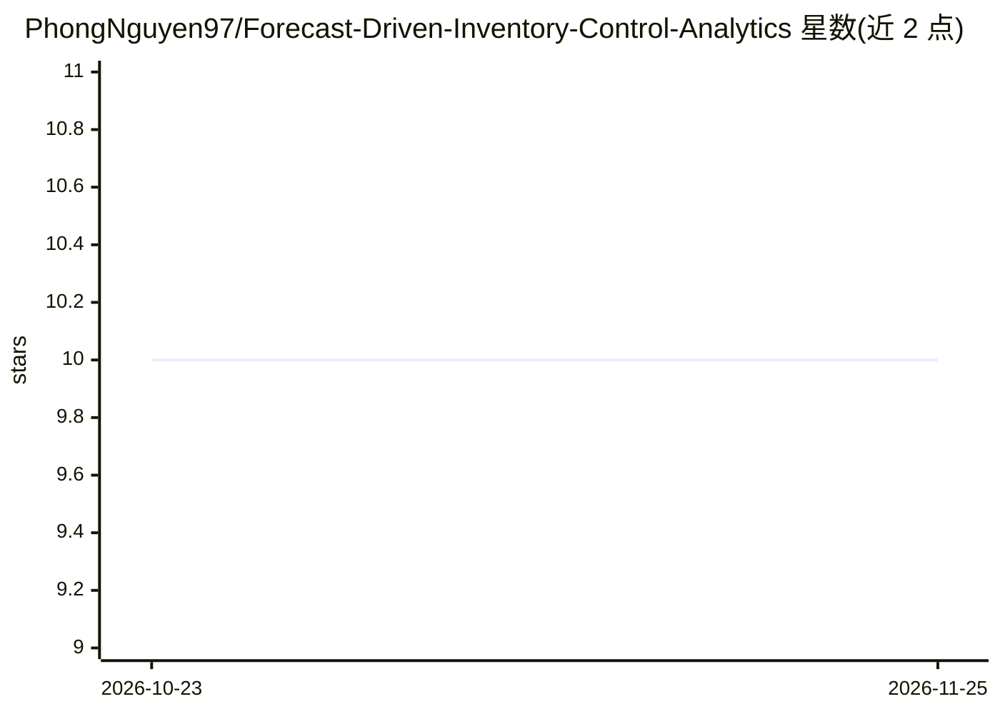

# PhongNguyen97/Forecast-Driven-Inventory-Control-Analytics

⭐ 10 · Jupyter Notebook · MIT · 推送 2026-06-08 · [GitHub](https://github.com/PhongNguyen97/Forecast-Driven-Inventory-Control-Analytics) · 个人维护

**面向零售需求计划的预测驱动库存优化分析项目**

将需求预测与库存策略优化连接起来的端到端供应链分析项目：用 SARIMAX 等传统时序模型与 XGBoost/LSTM 等机器学习模型对比生成商品族需求预测，通过混合路由规则与可行性审计选择最终模型，再以蒙特卡洛模拟随机需求路径，转化为安全库存、再订货点、订货量等补货策略参数，目标在随机周需求下达到至少 95% 客户满足率。数据基于厄瓜多尔 Favorita 零售门店销售数据（Kaggle）。

## 筛选速览

| 维度 | 判定 | 备注 |
|---|---|---|
| AI 角色 | `ai-native` | 本体是模型或模型工具 |
| 许可风险 | `permissive` | MIT |
| 部署形态 | `library` | 以包/库形式分发 |
| 模型依赖 | — | README 未给出锁定关系 |
| 硬件要求 | — | 无带数字的原话,不猜 |
| 安装摩擦 | `low` | 无编译、无系统依赖或容器化 |
| 成熟度 | — | 结构信号不足 |

## 能力要点

- SARIMAX 传统模型与 XGBoost/LSTM 等机器学习模型的对比与按商品族路由
- 可行性审计检查预测的连续性、季节合理性与外生驱动因素一致性
- 蒙特卡洛模拟随机需求路径并优化 (s,Q)/(R,S) 补货策略
- 周预测按历史星期权重拆解为日预测

## 适用场景

- 把零售需求预测转化为安全库存与再订货点等补货参数
- 评估不同提前期假设下库存策略的服务水平与成本
- 复现或学习预测与库存优化联动的完整分析流程

## 场景标签

 · 领域:供应链/数据分析

## 证据(README 行号)

> L3: An end-to-end supply chain analytics project that connects **demand forecasting** with **inventory policy optimizati
> L19: |**Demand Forecasting System**|Predict future product-family demand using traditional time-series models and machin
> L56: - machine learning and deep learning comparison;

## 星数曲线

2026-10-23 10 → 2026-11-25 10（+0）

---
*卡片 v1 · prompt 1.4 · 生成 2026-11-20 · 置信度 high · 依据 README sha `ff5e99002640` · [字段定义](../../DATASET.md)*
